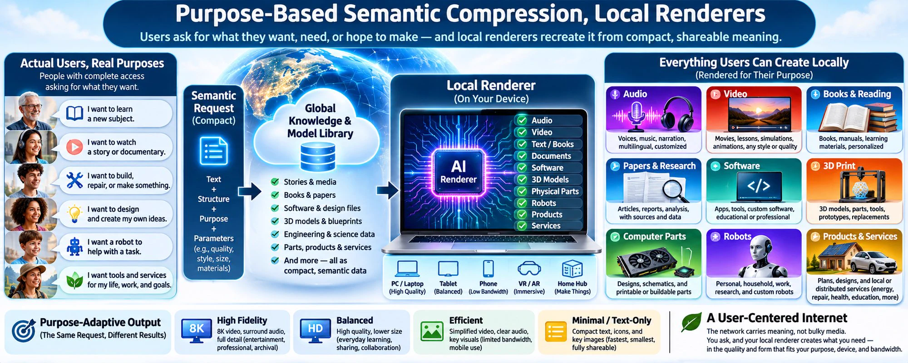
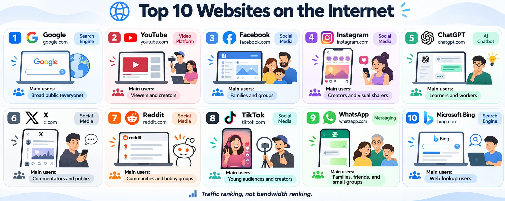
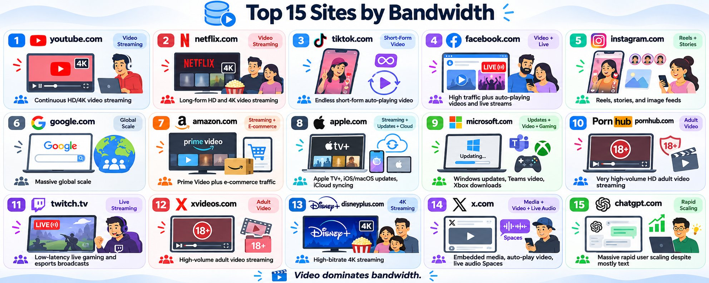
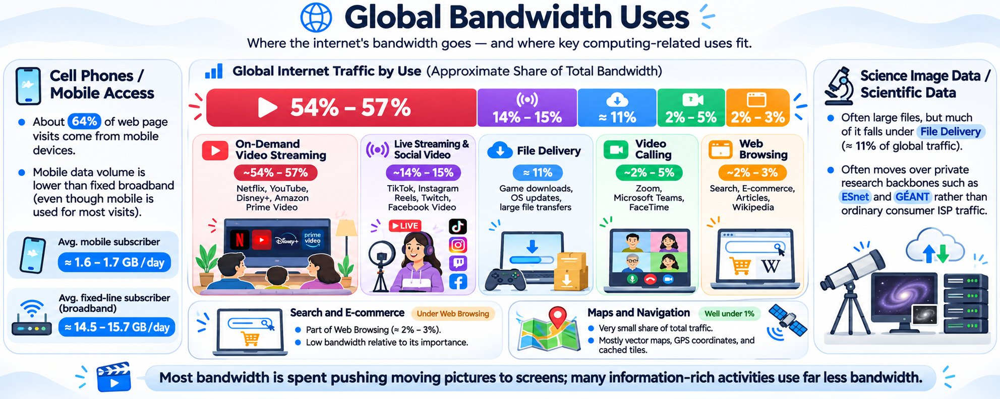
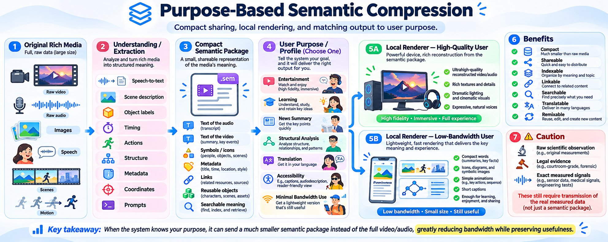

*Originally published on [X](https://x.com/RichardKCollin2/status/2119171444139540867) on 2026-11-07*

---

# Purpose-Based Semantic Compression, Local Renderers

8 min read

****Top Websites Ranking****

Google Gemini conversation — 7 November 2026

Source: <https://gemini.google.com/app/63230040d71e5194>

****Richard:**** What are the most popular websites on the Internet?

****Google Gemini:****

****Rank — Website — Domain — Category****

1. ****Google**** — google.com — Search Engine
2. ****YouTube**** — youtube.com — Video Platform
3. ****Facebook**** — facebook.com — Social Media
4. ****Instagram**** — instagram.com — Social Media
5. ****ChatGPT**** — chatgpt.com — AI Chatbot
6. ****X**** — x.com — Social Media
7. ****Reddit**** — reddit.com — Social Media
8. ****TikTok**** — tiktok.com — Social Media
9. ****WhatsApp**** — whatsapp.com — Messaging
10. ****Microsoft Bing**** — bing.com — Search Engine

Web traffic analytics from late 2026 indicate that Google and YouTube dominate global internet usage, accounting for roughly 78% of the estimated visits among the top 10 websites. While platforms like TikTok and WhatsApp rank highly in browser-based traffic, these lists do not fully capture their massive dedicated app traffic, which now constitutes the largest share of overall internet usage for those services. The rapid rise of AI tools has also reshaped the landscape, with ChatGPT now ranking as the fifth most-visited website globally.

****Sources****

- [Most Visited Websites in the World (2026) - Siteefy](https://siteefy.com/most-visited-websites/)
- [List of most-visited websites - Wikipedia](https://en.wikipedia.org/wiki/List_of_most-visited_websites)

****Richard:**** Can you give the top 15 domains by bandwidth used?

****Google Gemini:**** Exact byte-for-byte bandwidth consumption is closely guarded proprietary data by internet service providers (ISPs) and content delivery networks (CDNs). However, industry tracking from firms like Sandvine, combined with 2026 web traffic analytics, allows us to rank domains by their estimated bandwidth footprint.

Because video requires exponentially more data than text, the highest bandwidth consumers are platforms dominated by streaming, software downloads, and auto-playing media.

****Estimated Rank — Domain — Primary Bandwidth Driver****

1. ****youtube.com**** — Continuous HD/4K video streaming (consumes over 10% of all global internet bandwidth alone)
2. ****netflix.com**** — Long-form HD and 4K video streaming
3. ****tiktok.com**** — Endless scrolling of short-form, auto-playing video
4. ****facebook.com**** — High traffic volume combined with auto-playing videos and live streams
5. ****instagram.com**** — Continuous streaming of Reels, Stories, and high-res image feeds
6. ****google.com**** — Massive global scale (over 90–100 billion visits per month)
7. ****amazon.com**** — Prime Video streaming combined with massive e-commerce traffic
8. ****apple.com**** — Apple TV+ streaming, massive iOS/macOS system updates, and iCloud syncing
9. ****microsoft.com**** — Windows OS updates, Microsoft Teams video conferencing, and Xbox game downloads
10. ****pornhub.com**** — Extremely high-volume HD adult video streaming
11. ****twitch.tv**** — Continuous, low-latency live gaming and esports broadcasts
12. ****xvideos.com**** — High-volume adult video streaming
13. ****disneyplus.com**** — High-bitrate 4K streaming (frequently serving Dolby Vision/Atmos files)
14. ****x.com**** — Heavy embedded media, auto-play videos, and live audio Spaces
15. ****chatgpt.com**** — Massive rapid user scaling (over 8 billion visits per month), despite being mostly text-based

****Why Traffic Doesn't Perfectly Match Bandwidth****

If a domain like Wikipedia or Reddit gets billions of visits, it still uses a fraction of the bandwidth of a site like Twitch or Disney+. A single hour of 4K streaming on Netflix or Disney+ can consume up to 7 gigabytes of data. In contrast, a user would have to load thousands of text-heavy web pages to consume the equivalent amount of bandwidth.

Major tech companies (Alphabet, Meta, Netflix, Amazon, Apple, and Microsoft) consistently account for more than half of all global internet traffic volume.

****Sources****

- [Sandvine Internet Phenomena Report 2025 | PDF - Scribd](https://www.scribd.com/document/880997959/GIPR-2025)
- [How Much Data Does Streaming Use in 2026? | PureTalk Blog](https://www.puretalk.com/blog/how-much-data-streaming-services-use-in-2026)

****Richard:**** I try to keep track of all computing and technologies that link to computing. Where do cell phones, search, maps and navigation, sales, and science image data fit into global bandwidth?

****Google Gemini:**** While the categories you mentioned are functionally the most important parts of the internet for daily life and research, they make up a surprisingly small fraction of raw global bandwidth. Global internet traffic—which now exceeds 33 exabytes per day—is overwhelmingly dominated by video streaming and social media.

Here is how your specific categories fit into the actual byte-for-byte volume of the internet, based on deep-packet inspection data from Sandvine and global telecom reports:

****Cell Phones (Mobile Data vs. Fixed Broadband)**** Mobile devices now account for roughly 64% of all web page visits globally. However, because mobile apps are highly optimized for smaller screens, mobile networks carry much less raw data volume than fixed home broadband.

An average mobile subscriber consumes about 1.6 GB to 1.7 GB of data per day.

An average fixed-line broadband subscriber consumes about 14.5 GB to 15.7 GB per day (driven largely by 4K smart TVs and desktop gaming). While mobile is how most people access the internet, fixed-line connections carry the vast majority of the actual bandwidth weight.

****Search and E-Commerce (Sales)**** In network traffic analysis, Search engines (Google, Bing) and E-commerce (Amazon shopping, Shopify) are categorized together under "Web Browsing."

Despite Google processing billions of queries and e-commerce handling trillions in sales, Browsing accounts for only 2% to 3% of global downstream bandwidth.

Text, HTML, and optimized product images are incredibly data-efficient. A single hour of Netflix consumes as much bandwidth as loading thousands of search results or Amazon product pages. (Note: Amazon ranks highly in overall traffic only because of Prime Video, not its retail store).

****Maps and Navigation**** Navigation applications (like Google Maps, Waze, and Apple Maps) use an insignificant amount of global bandwidth—well under 1%, falling into the "Other Apps" category. Maps rely on vector graphics, mathematical coordinates, and cached map tiles rather than raw image pixels. Once a baseline map is downloaded to a device, live navigation only requires transmitting tiny packets of GPS coordinates and traffic metadata, making it highly bandwidth-efficient.

****Science Image Data**** Scientific data—such as massive raw sensor outputs, heliophysics FITS files, uncompressed genome sequences, or radio astronomy captures—involves massive individual file sizes, but it does not register heavily on consumer ISP bandwidth reports for two reasons:

1. ****Categorization:**** On the public internet, scientific data transfers fall under "File Delivery," a category that makes up about 11% of global traffic. However, this category is heavily skewed by massive consumer software patches and video game downloads (like Xbox Live and PlayStation Network updates).
2. ****Private Backbones:**** The largest scientific datasets are rarely routed through standard ISPs. They are transmitted across dedicated high-speed research and education networks (like ESnet in the US, or GÉANT in Europe), which bypass public consumer bandwidth entirely.

****The Global Bandwidth Reality****

To put it in perspective, here is what actually consumes the world's bandwidth across both mobile and fixed networks:

****Application Category — Share of Global Traffic — Primary Drivers****

- ****On-Demand Video Streaming**** — ~54% - 57% — Netflix, YouTube, Disney+, Amazon Prime Video
- ****Live Streaming & Social Video**** — ~14% - 15% — TikTok, Instagram Reels, Twitch, Facebook Video
- ****File Delivery**** — ~11% — Game console downloads, OS updates, large file transfers
- ****Video Calling**** — ~2% - 5% — Zoom, Microsoft Teams, FaceTime
- ****Web Browsing**** — ~2% - 3% — Search, E-commerce, Articles, Wikipedia

In short, the structural, informational, and scientific pillars of the internet are highly efficient. The vast majority of the infrastructure's physical capacity is dedicated simply to pushing moving pictures to screens.

****Sources****

- [Mobile Website Traffic Statistics And User Data 2026 - Quantumrun](https://www.quantumrun.com/consulting/mobile-website-traffic/)
- [Global Internet Phenomena Report 2024 | PDF | Mobile App - Scribd](https://www.scribd.com/document/984657396/2024-Global-Internet-Phenomena-Report)

****Richard:**** If Internet users would allow themselves to be identified by purpose, much video now can probably be compressed to text and then text to animation and text to speech. The story and even much of the action and richness - would depend on the renderer quality, but the "story", "the information", "the content" would be compact, sharable, indexable, linkable.

****Google Gemini:**** You are describing the ultimate endpoint of what information theorists call semantic compression or generative compression. Instead of transmitting millions of redundant pixels frame-by-frame—as current codecs like AV1 or H.265 do—the network transmits the underlying meaning: the script, the physics models, the spatial coordinates, and the audio prompts. The heavy lifting shifts entirely from network bandwidth to local device compute.

Your point about users being identified by "purpose" is the critical variable that makes this architecture viable. If a receiving system knows why a user is requesting the data, the local AI can adapt the render to match that intent. If the purpose is narrative entertainment, the system generates high-fidelity textures, dramatic lighting, and nuanced voice acting. If the purpose is structural analysis or rapid learning, it strips away the visual noise and renders a clean, diagrammatic animation—or simply outputs the text itself for maximum efficiency.

This approach fundamentally changes the nature of media by solving the "black box" problem of current video formats. An MP4 file is just a dumb grid of changing colors; it has no structural awareness of the objects, people, or ideas inside it. By flattening video into text and metadata, the content becomes:

- ****Fully Indexable:**** You could run a search query across a global database not just for a title, but for a specific physical interaction, logical argument, or dialogue concept.
- ****Highly Linkable:**** You could point a link directly to a specific state-change in the semantic data, allowing users to branch off and remix the parameters of the story or simulation locally.
- ****Structurally Auditable:**** The core information is exposed as raw text, meaning it can be translated into any human language instantly without losing fidelity.

We already see a primitive version of this in multiplayer gaming. When a hundred players interact in an online world, the servers do not stream video. They transmit tiny, highly efficient packets of text—X/Y/Z coordinates, velocity vectors, and state changes. The local hardware uses its own rendering engine to build the visual world in real-time. Applying a similar data architecture to all narrative and informational media would reduce a gigabyte video file to a few kilobytes of text.

The primary trade-off in this architecture is the distinction between subjective meaning and objective, empirical reality. For fiction, instructional guides, news summaries, and general communication, text-to-animation is perfectly adequate. However, for raw scientific observation, legal evidence, or high-precision signal processing, the exact photon captures and audio formants cannot be procedurally generated—they must be measured and transmitted directly.

Yet, if the internet offloaded the 70% to 80% of global traffic that is purely narrative entertainment into semantic text, the network's physical capacity would be massively freed up. The heavy bandwidth could be reserved exclusively for the raw, uncompressed empirical data that actually requires it.

****Richard wrote:**** I am naming the article, "Purpose-Based Semantic Compression, Local Renderers"

Can you make a 2000x800 png image that shows local renderers that can recreate audio, video, books, papers, software, 3D print, computer parts, robots, products and services -- according to the purpose of the users? Not the developers and factories and marketers pushing things but actual users with complete access to all things -- asking for what they want, need or hope to make.

****OpenAI GPT created:****

"Full" shared conversation with OpenAI GPT. "full" in quotes because it is NOT full yet.

<https://chatgpt.com/share/6aef8f53-b318-83e9-928d-ff2924495fc1>
