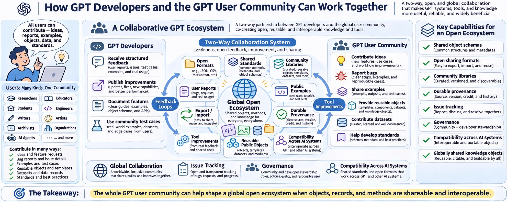
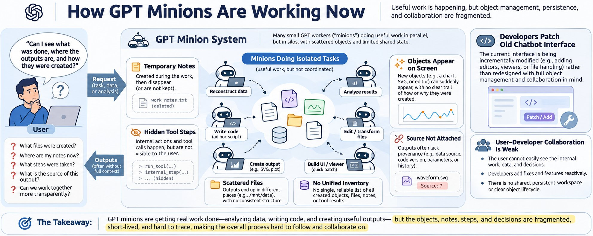
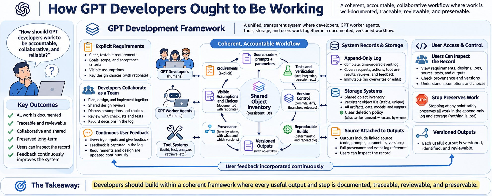
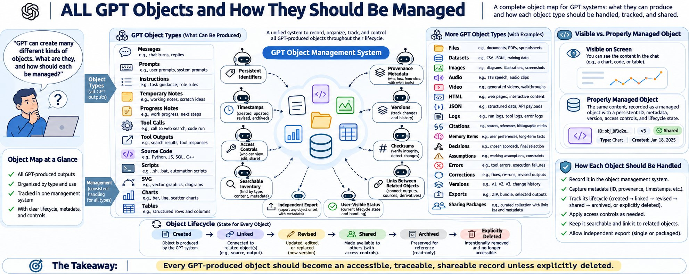
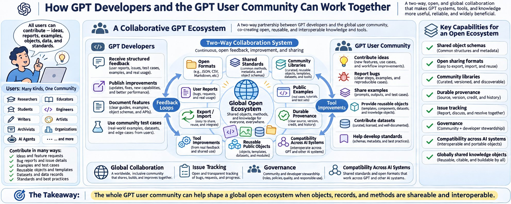
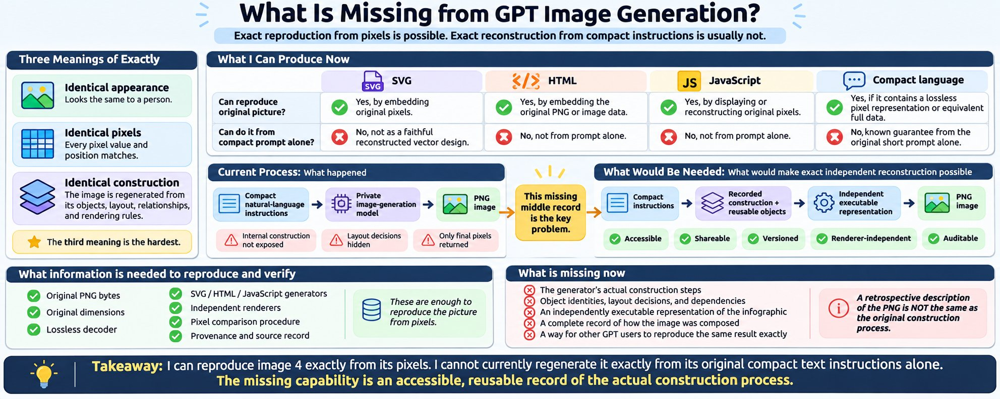

*Originally published on [X](https://x.com/RichardKCollin2/status/2119394523130273961) on 2026-11-08*

---

# AI Interface Requirements, Records and Products of AI Conversations

31 min read

****Richard wrote to OpenAI GPT :**** Do you keep your objects and files and outputs (products) in an internal storage area? in a database? Or just scattered where ever it feels valid? I get the impression that the developer group is not a team, but individuals just doing stuff and not in a framework. And not aiming to equip the GPT users with tools, but just updating an old chatbot interface that started out as demos.

****OpenAI GPT produced:**** Yes. ChatGPT has internal storage for conversations, files and generated products. But I do not have evidence that it maintains one unified, permanent, accessible inventory of every object and operation involved in our work.

There is an important distinction between having storage infrastructure and having a coherent information-management system that users and AIs can inspect, maintain and share.

Your screenshot illustrates the problem. You can see the Python source in a code viewer, but there is no obvious connection to a complete inventory showing the original SVG, the generating equations, the execution record, subsequent revisions, verification results and related conversations.

### 1. Where ChatGPT keeps things

Based on what I can access in this session and OpenAI's current documentation:

- Component
- What it stores or handles
- What I know
- Conversation history
- Messages and conversation content
- Saved chats are retained until deleted, subject to applicable policies
- Library
- Uploaded and generated files
- Provides a persistent file collection with search and downloads
- Execution environment
- Files created while Python and other tools run
- I can write files in /mnt/data, but that workspace is not itself a permanent archive
- Generated interface objects
- Inline SVG, charts, interactive controls
- Not necessarily represented as independently retrievable files
- Tool execution
- Inputs, results, errors and intermediate operations
- No complete user-accessible permanent event log is guaranteed
- Internal processing
- Temporary computations and model processing

I cannot inspect the complete internal storage or retention arrangements

OpenAI confirms that uploaded and generated files are saved in Library, separately from conversations, and that the system has distinct retention rules for chats, Library files and transient files.

OpenAI Help Center+1

So the answer is not that everything is merely scattered randomly.

There are established storage facilities. But their existence does not establish a unified system of object identity, provenance, relationships, version history and permanent accountability.

I also cannot tell you whether the underlying services use a relational database, an object store, several databases or some combination. Those implementation details are not visible to me.

### 2. What I can actually control

When I generate a Python program, SVG or other file, I can ordinarily write it to a working filesystem, such as /mnt/data.

I can then provide a file attachment or download link. The file may also become available through ChatGPT's Library.

But I do not control the underlying persistent storage architecture. I cannot directly create database tables, maintain a permanent account-wide object registry, inspect all internal records or guarantee that every intermediate product has been preserved.

More importantly, creating a file does not automatically establish all its relationships to the work that produced it.

For example, the waveform involved several distinct objects: the inline SVG, mathematical expressions, Python reconstruction, standalone SVG, HTML editor, verification image, execution results and your corrections.

Those objects should have been registered together as a related set. Instead, we had to reconstruct and document those relationships manually.

That is a failure of the workflow, regardless of how sophisticated the storage infrastructure behind it may be.

### 3. What about the developers?

I cannot verify your impression that the development groups are individuals working independently rather than a coordinated team. I have no access to their internal organizational structures, engineering plans, code reviews or project-management records.

But your observations support a more specific criticism.

The product presents multiple capabilities without consistently exposing a single, user-controlled information architecture connecting them.

There is conversation history, Library, generated files, code viewers, temporary execution, interactive visualizations, memory and data export.

These capabilities can be individually useful while still failing to form one coherent system for managing collaborative work.

That is an observable product-design issue. It does not require assuming anything about the developers' motives or competence.

### 4. What I think is missing

The missing system is not another file manager or an application that saves keystrokes.

It is a permanent record of entities, objects, operations and relationships, with defined responsibilities for the humans, AIs, programs and organizations participating in the work.

Every participating entity should have access to the records appropriate to its role. Every newly created product should have provenance, a durable identity and an explicit relationship to its inputs, outputs and originating events.

A user should be able to ask:

- What objects were created during this conversation?
- What exact source programs and input data produced each one?
- What operations were executed, including failures and corrections?
- Which objects were revised, superseded or deleted?
- Where are the original records, and who can access or share them?

These should be ordinary database queries, not investigations that require repeatedly questioning the AI.

And when an AI is stopped, the system should preserve the observable record of its completed work rather than relying on the AI to reconstruct that history afterward.

### 5. A distinction that matters

OpenAI provides a way to export ChatGPT account data, including conversation history, but that does not guarantee a complete, independently verifiable record of every intermediate operation and generated object.

OpenAI Help Center

Your requirement is substantially stronger: an append-only, independently verifiable work history, with original records retained unless explicitly deleted under an established policy.

I would not describe ChatGPT today as providing that guarantee.

My conclusion: ChatGPT has real storage, file-generation and information-retrieval capabilities. What remains unestablished is whether they are governed by one comprehensive information model designed around permanent collaborative work rather than separate application features.

And that is the central design question you are raising: Is the AI being equipped to participate as a responsible, accountable entity in a shared information system, or is it primarily being fitted with additional capabilities inside a conversational interface?

The behavior we have examined in this session demonstrates why that distinction matters.

****Richard wrote to OpenAI GPT :**** To get what I want, do I have to find some GPT api and write my own databases, object management libraries, sharing formats and make my own system? Abandon this interface (presumably used by millions who might benefit from improvements)?

****OpenAI GPT produced:**** No. You should not have to abandon ChatGPT, build your own AI interface, or recreate databases, object-management libraries and sharing standards simply to obtain a complete, permanent record of your work.

And I would not recommend abandoning this interface as your first response to these problems.

You are asking for something that should be a fundamental capability of a collaborative AI system, not a specialized application that every technically capable user must independently construct.

There are three separate objectives here:

1. Preserve your own work now, without depending on undocumented behavior or temporary storage.
2. Improve ChatGPT itself, so the benefits reach millions of users rather than being confined to a personal replacement system.
3. Establish open, interoperable records, so conversations, tools, programs, measurements, files and their histories can be shared across different AI systems.

Those objectives are compatible. The difficulty is that ChatGPT's existing features do not yet provide every guarantee you are asking for.

### What is available today?

I checked OpenAI's current documentation. The following distinction is important.

- Capability
- Available today?
- Does it satisfy your requirement?
- Saved ChatGPT conversations
- Yes
- Only part of the record
- Searchable Library of generated files
- Yes
- Files, but not every intermediate object
- ChatGPT Projects with related chats and files
- Yes
- Organization, not a complete audit trail
- Export of conversation history
- Yes
- Not every underlying operation
- API conversations with durable identifiers
- Yes
- Useful infrastructure, but separate from this ChatGPT session
- Complete automatic preservation of visible progress, tools and intermediate objects
- No documented general guarantee
- No
- Permanent, independently verifiable legal record
- No documented general guarantee
- No

OpenAI's documentation confirms that Library can retain generated files independently of chats, while Projects group related chats and files. Personal-account data exports are also available, but none of these features guarantees a complete execution history.

OpenAI Help Center+3

The API is not necessarily the solution

OpenAI already has a [Conversations API](https://developers.openai.com/api/docs/guides/conversation-state?utm_source=chatgpt.com) that creates persistent conversation objects with identifiers and stores messages, tool calls, tool outputs and related items. Its conversation records are not subject to the default 30-day response retention limit.

OpenAI API+1

That is useful infrastructure.

But it does not give you a complete interface to the internal history of your existing ChatGPT conversations. Nor does it automatically produce your desired permanent object inventory, provenance graph or complete record of the AI's operations.

Building an API application would give you more control over events that your application can observe. It would also make you responsible for building and maintaining parts of the system yourself.

You would be trading an existing interface problem for a significant software-maintenance obligation, without gaining access to all the information you originally wanted preserved.

### What I recommend instead

I would pursue two paths simultaneously.

First, keep using ChatGPT and its existing capabilities. For work that must be preserved today, use Projects and Library, retain original source files and generated products, and periodically export your account data to storage you control. This gives you some independence from ChatGPT's retention and interface behavior, although it cannot recover intermediate information the system never exposed or saved.

Second, pursue the change at the ChatGPT product level. Your example from this conversation is concrete enough to describe a reproducible product deficiency:

- An AI-generated SVG was displayed without becoming an identifiable, independently accessible object.
- Generating equations, source programs and verification operations were not automatically associated with the object.
- Visible progress disappeared or was no longer accessible after interruption.
- Recovering the object's history required repeated requests and retrospective reconstruction.

The corresponding product requirement is straightforward:

Every observable work event and every created object must be recorded automatically in an append-only, inspectable session history, with accessible source data, persistent identifiers, provenance and independent export. Stop must preserve completed events.

This should be implemented in the underlying ChatGPT information system, rather than requiring every AI or user to invent a different solution.

OpenAI offers an official [support contact procedure](https://help.openai.com/en/articles/6614161-how-can-i-contact-support?utm_source=chatgpt.com) through its Help Center. You can submit the observed failure, screenshots and requested behavior. I cannot guarantee that such a report will reach the relevant engineering team or produce a change.

OpenAI Help Center

### What if you eventually build something?

I would not begin with a replacement chatbot.

If existing tools remain insufficient, the smallest useful independent component would be an open session-record format and archive, designed to coexist with ChatGPT, Grok, Gemini, local AI programs and ordinary scientific software.

It need not start with a large database or complicated application. It could begin with content-addressed files, a machine-readable object inventory, a chronological event log and a standard package format.

But an external archiver can only preserve what a platform makes available. It cannot guarantee capture of hidden operations or material that disappears before it can be recorded. Fixing that requires cooperation from the platform.

That is precisely why improvements to ChatGPT itself matter.

### The larger point

There is something inefficient about requiring technically competent users to build elaborate independent systems merely to recover information that the original software has already processed.

It duplicates infrastructure, fragments standards, wastes computing and development effort, and excludes people who cannot program.

You have spent this conversation specifying requirements that would benefit not just software developers, but anyone using an AI for research, education, engineering, business, creative work or personal records.

You should be able to use ChatGPT as a participant in a permanent, open, accountable information system—not have to replace ChatGPT to create one.

The practical answer is that you can preserve more of your work immediately with existing facilities, but satisfying your full requirement needs changes to the platform. An API-based private replacement is neither necessary as a first step nor sufficient as a complete solution.

****Richard wrote to OpenAI GPT :**** Can you make

1. A 2000x800 png showing how the GPT minions are working now.
2. A 2000x800 png showing how the GPT developers ought be working
3. A 2000x800 png showing ALL the GPT objects that can be produced, and how that should be managed, preserved, accessible.
4. A 2000x800 png showing how GPT developers can work with their entire GPT user community so all things that GPT users might create can be shared in global open communities.

****OpenAI GPT produced: (it did not make valid filenames)****

A 2000x800 png showing how the GPT minions are working now.

A 2000x800 png showing how the GPT developers ought be working

A 2000x800 png showing ALL the GPT objects that can be produced, and how that should be managed, preserved, accessible.

A 2000x800 png showing how GPT developers can work with their entire GPT user community so all things that GPT users might create can be shared in global open communities.

****Richard wrote to OpenAI GPT :**** How did you create the 4th image? Did you first compose it in a formal layout language or work framework? Or did you just write some stuff in a semi-formal way with token ids and send it to an image creation app without logs or records?

****OpenAI GPT produced:**** I used the second method. I wrote a detailed natural-language description of the fourth image, with some semi-structured layout instructions, and sent it to an image-generation model.

I did not first construct the image in a formal layout language, such as SVG, HTML/CSS, or a structured drawing specification with explicit coordinates and dimensions.

There was no independent object model defining every panel, arrow, caption, symbol and relationship. The image-generation model interpreted my description and decided how to arrange and render the elements.

### What actually happened

1. I generated the first image, establishing a visual style.
2. I prepared descriptions for images 2, 3 and 4 in a batch.
3. The first batch submission failed validation because I supplied an invalid animation setting.
4. I corrected the submission and generated the three remaining images.
5. For image 4, I supplied the first image as a visual style reference.
6. The model returned a rendered PNG, along with generation metadata and a descriptive caption.

The fourth image's instructions included the exact title, the intended left and right panels, the central global collaboration network, categories of participants, labeled information flows, and the concluding statement.

But those were instructions to a generative model, not a formally defined graphic that could be independently rendered, tested, modified and reproduced.

The result was 1983 × 793 pixels, rather than your requested 2000 × 800 pixels. I did not correct that discrepancy before presenting it.

### What I recorded and what was missing

The generation service returned this identifier:

1581d793-83e0-4c9e-aafe-249f390e5050

That identifies the generation result in the tool response, but it is not a complete provenance record.

I did not preserve an independent execution log at generation time. I did not receive the model's internal layout decisions, an editable vector source, or a reproducible random seed.

I have now created a retrospective provenance record containing the exact instruction text I submitted, the reference image, the failed and successful submission details, the generation identifier, actual dimensions and SHA-256 file checksums.

- How GPT Developers and the GPT User Community Can Work Together — Original PNG
- How GPT Developers and the GPT User Community Can Work Together — Provenance V1.json

The important distinction is that this record documents the instructions and observable execution, not the image model's underlying composition process.

I described an accountable engineering framework in the image, but I did not use such a framework to produce the image.

That contradiction is worth highlighting. It is exactly the problem you have been asking us to address: an AI can describe a disciplined, reproducible workflow convincingly without actually following one.

****Richard wrote to OpenAI GPT :**** None of "SVG, HTML/CSS, or a structured drawing specification with explicit coordinates and dimensions" is a formal layout language. Not at the level of this infographic.

Show me in text, what you sent to make image 4. "wrote a detailed natural-language description of the fourth image, with some semi-structured layout instructions, and sent it to an image-generation model." It needs to stand outside the "how we have been doing it using an existing app".

****OpenAI GPT produced:**** You are correct. SVG and HTML/CSS are rendering technologies. They are not, by themselves, formal languages for designing and reasoning about the content, relationships, hierarchy and constraints of a complex infographic.

Here is the exact natural-language prompt I submitted for image 4, without rewriting or summarizing it.

### Original instructions sent to the image generator

Copy promptImage 4 — Original generation prompt

Create Image 4 of the same 4-image series. Image A is the style and layout anchor. Match its clean light infographic look, typography scale, icon style, rounded panels, and clear readable labels, while making a new composition and content. Title: "How GPT Developers and the GPT User Community Can Work Together". Show a large collaborative ecosystem linking GPT developers, GPT users, local projects, global open communities, tools, shared standards, and reusable public objects. Visualize a two-way collaboration system rather than a top-down pipeline. Include users of many kinds—researchers, educators, students, engineers, writers, artists, archivists, organizations, and AI agents—contributing ideas, bug reports, examples, reusable objects, templates, datasets, and standards. Show developers receiving structured feedback, publishing improvements, documenting features, and using community test cases. Emphasize open sharing formats, shared object schemas, community libraries, export/import, durable provenance, issue tracking, governance, compatibility across AI systems, and globally shared knowledge objects. Include labeled concepts such as: "user reports", "shared standards", "community libraries", "open formats", "public examples", "global collaboration", "feedback loops", "tool improvements", and "all users can contribute". Make the bottom takeaway explicit: the whole GPT user community can help shape a global open ecosystem when objects, records, and methods are shareable and interoperable.

### What accompanied that text

The generation request also contained:

- Field
- Value
- Style reference
- PNG of image 1 in the series
- Requested aspect ratio
- 5:2
- Transparent background
- False
- Generation method
- Image model, batched with images 2 and 3
- Result identifier
- 1581d793-83e0-4c9e-aafe-249f390e5050
- Actual output dimensions
- 1983 × 793 pixels

The long, detailed description of the final image that appeared afterward was generated by the image model after rendering. It was not an input I had designed or validated beforehand.

I saved the original prompt and submission metadata together as a standalone text record:

Download Image 4 Original Generation Instructions — V1.txt

### What this reveals about the method

Notice what I did not specify in the prompt: the actual panel inventory, precise relationships between individual elements, allocation of visual area, text placement constraints, rendering priorities, or tests for completeness and legibility.

I described the desired concepts and a general visual character. The image generator independently invented the detailed composition.

For a formal infographic specification, I would separate at least three layers:

1. Semantic model: Every concept, entity, object, relationship, assertion, explanation and source that the infographic must represent.
2. Presentation model: Visual hierarchy, grouping, relationships, layout constraints, allocation of space, reading order and required labels.
3. Rendering model: The mapping from that specification into SVG, raster graphics, HTML, print or another presentation medium.

The first two should be independent of whichever image-generation application happens to be available. The third should be replaceable.

That would allow an AI or a human to inspect the design before rendering, validate whether all intended concepts and relationships are represented, and reconstruct or revise individual parts without starting from a new prose prompt.

What I actually sent was not a formal infographic specification. It was an informal natural-language request, augmented by a reference image and a few generation parameters.

The distinction is consequential: we have a rendered picture, but not a complete, editable, machine-verifiable representation of the intellectual and visual design that produced it.

****==== Download Image 4 Original Generation Instructions — V1.txt ====****

How GPT Developers and the GPT User Community Can Work Together Original instructions sent for image 4 — OpenAI GPT-6 — 2026-11-08 STATUS: Retrospective transcription of the successful tool submission from the visible conversation. This text is not a formal infographic layout or a reproduction recipe. EXACT PROMPT FIELD: Create Image 4 of the same 4-image series. Image A is the style and layout anchor. Match its clean light infographic look, typography scale, icon style, rounded panels, and clear readable labels, while making a new composition and content. Title: "How GPT Developers and the GPT User Community Can Work Together". Show a large collaborative ecosystem linking GPT developers, GPT users, local projects, global open communities, tools, shared standards, and reusable public objects. Visualize a two-way collaboration system rather than a top-down pipeline. Include users of many kinds—researchers, educators, students, engineers, writers, artists, archivists, organizations, and AI agents—contributing ideas, bug reports, examples, reusable objects, templates, datasets, and standards. Show developers receiving structured feedback, publishing improvements, documenting features, and using community test cases. Emphasize open sharing formats, shared object schemas, community libraries, export/import, durable provenance, issue tracking, governance, compatibility across AI systems, and globally shared knowledge objects. Include labeled concepts such as: "user reports", "shared standards", "community libraries", "open formats", "public examples", "global collaboration", "feedback loops", "tool improvements", and "all users can contribute". Make the bottom takeaway explicit: the whole GPT user community can help shape a global open ecosystem when objects, records, and methods are shareable and interoperable.   
  
ADDITIONAL SUBMISSION FIELDS (not part of prompt text): - Submitted as third entry of a three-image batch (images 2–4). - Style reference path: /mnt/data/ghostwriter\_images/generated/a\_wide\_highly\_detailed\_infographic\_in\_a\_clean\_mo\_1.png - aspect\_ratio: 5:2 - transparent\_background: false - animation: null - referenced\_image\_ids: [] - A preceding batch submission, with identical prompt, failed validation because an animation frame\_count of 1 was used. The corrected submission succeeded. - Generation result ID: 1581d793-83e0-4c9e-aafe-249f390e5050 - Returned image dimensions: 1983 x 793 pixels, not exactly the requested 2000 x 800.   
  
IMPORTANT PROVENANCE LIMITATIONS: - The reference image is a separate input. Without retaining its original bytes, the text prompt alone does not capture the full input. - The rendered image's internal element positions and design decisions were made by the generation model, not supplied as a structured, machine-verifiable layout. - Neither a seed nor an editable vector design was supplied in the available response. - The image model's descriptive caption was returned \*after\* rendering; it was not part of the instructions sent to generate the image.

====

****Richard wrote to OpenAI GPT :**** "a detailed natural-language description of the fourth image, with some semi-structured layout instructions" --- it can be formalized. The areas on the image, the original descriptors, the links back to my instructions, what actually happened in the image maker.

1. Title: "How GPT Developers and the GPT User Community Can Work Together".
2. Show a large collaborative ecosystem linking GPT developers, GPT users, local projects, global open communities, tools, shared standards, and reusable public objects.
3. Visualize a two-way collaboration system rather than a top-down pipeline.
4. Include users of many kinds—researchers, educators, students, engineers, writers, artists, archivists, organizations, and AI agents—contributing ideas, bug reports, examples, reusable objects, templates, datasets, and standards.
5. Show developers receiving structured feedback, publishing improvements, documenting features, and using community test cases.
6. Emphasize (1) open sharing formats, (2) shared object schemas, (3) community libraries, export/import, (4) durable provenance, (5) issue tracking, governance, (6) compatibility across AI systems, and (7) globally shared knowledge objects.
7. Include labeled concepts such as: "user reports", "shared standards", "community libraries", "open formats", "public examples", "global collaboration", "feedback loops", "tool improvements", and "all users can contribute".
8. Make the bottom takeaway explicit: the whole GPT user community can help shape a global open ecosystem when objects, records, and methods are shareable and interoperable.

****OpenAI GPT produced:**** Yes. It ****can**** be formalized.

What I sent to the image maker was informal prose. But your 8 points can be turned into a structured specification that stands ****outside**** any particular image app.

Below is one way to do it.

### 1. Formalized infographic specification

InfographicSpec:  
 spec\_id: IMG4\_SPEC\_V1  
 title: "How GPT Developers and the GPT User Community Can Work Together"  
 purpose:  
 primary: "Describe a two-way collaborative ecosystem between GPT developers and the GPT user community."  
 secondary: "Show how shared objects, standards, feedback, and reusable public resources can support a global open ecosystem."  
 source\_requirements:  
 - req\_id: R1  
 text: 'Title: "How GPT Developers and the GPT User Community Can Work Together".'  
 - req\_id: R2  
 text: "Show a large collaborative ecosystem linking GPT developers, GPT users, local projects, global open communities, tools, shared standards, and reusable public objects."  
 - req\_id: R3  
 text: "Visualize a two-way collaboration system rather than a top-down pipeline."  
 - req\_id: R4  
 text: "Include users of many kinds—researchers, educators, students, engineers, writers, artists, archivists, organizations, and AI agents—contributing ideas, bug reports, examples, reusable objects, templates, datasets, and standards."  
 - req\_id: R5  
 text: "Show developers receiving structured feedback, publishing improvements, documenting features, and using community test cases."  
 - req\_id: R6  
 text: "Emphasize (1) open sharing formats, (2) shared object schemas, (3) community libraries, export/import, (4) durable provenance, (5) issue tracking, governance, (6) compatibility across AI systems, and (7) globally shared knowledge objects."  
 - req\_id: R7  
 text: 'Include labeled concepts such as: "user reports", "shared standards", "community libraries", "open formats", "public examples", "global collaboration", "feedback loops", "tool improvements", and "all users can contribute".'  
 - req\_id: R8  
 text: "Make the bottom takeaway explicit: the whole GPT user community can help shape a global open ecosystem when objects, records, and methods are shareable and interoperable."  
  
 semantic\_model:  
 entities:  
 - entity\_id: E1  
 name: GPT Developers  
 type: actor\_group  
 - entity\_id: E2  
 name: GPT User Community  
 type: actor\_group  
 - entity\_id: E3  
 name: Local Projects  
 type: collaboration\_context  
 - entity\_id: E4  
 name: Global Open Communities  
 type: collaboration\_context  
 - entity\_id: E5  
 name: Tools  
 type: system\_component  
 - entity\_id: E6  
 name: Shared Standards  
 type: governance\_structure  
 - entity\_id: E7  
 name: Reusable Public Objects  
 type: object\_group  
 - entity\_id: E8  
 name: Researchers  
 type: user\_subgroup  
 - entity\_id: E9  
 name: Educators  
 type: user\_subgroup  
 - entity\_id: E10  
 name: Students  
 type: user\_subgroup  
 - entity\_id: E11  
 name: Engineers  
 type: user\_subgroup  
 - entity\_id: E12  
 name: Writers  
 type: user\_subgroup  
 - entity\_id: E13  
 name: Artists  
 type: user\_subgroup  
 - entity\_id: E14  
 name: Archivists  
 type: user\_subgroup  
 - entity\_id: E15  
 name: Organizations  
 type: user\_subgroup  
 - entity\_id: E16  
 name: AI Agents  
 type: user\_subgroup  
  
 contribution\_types:  
 - C1: ideas  
 - C2: bug\_reports  
 - C3: examples  
 - C4: reusable\_objects  
 - C5: templates  
 - C6: datasets  
 - C7: standards  
  
 developer\_actions:  
 - D1: receive\_structured\_feedback  
 - D2: publish\_improvements  
 - D3: document\_features  
 - D4: use\_community\_test\_cases  
  
 emphasized\_capabilities:  
 - K1: open\_sharing\_formats  
 - K2: shared\_object\_schemas  
 - K3: community\_libraries  
 - K4: export\_import  
 - K5: durable\_provenance  
 - K6: issue\_tracking  
 - K7: governance  
 - K8: compatibility\_across\_ai\_systems  
 - K9: globally\_shared\_knowledge\_objects  
  
 required\_labels:  
 - L1: "user reports"  
 - L2: "shared standards"  
 - L3: "community libraries"  
 - L4: "open formats"  
 - L5: "public examples"  
 - L6: "global collaboration"  
 - L7: "feedback loops"  
 - L8: "tool improvements"  
 - L9: "all users can contribute"  
  
 required\_takeaway:  
 text: "The whole GPT user community can help shape a global open ecosystem when objects, records, and methods are shareable and interoperable."  
  
 relationship\_model:  
 - rel\_id: REL1  
 from: E2  
 to: E1  
 type: feedback\_flow  
 label: "user reports / ideas / bug reports / examples"  
 directionality: bidirectional  
 - rel\_id: REL2  
 from: E1  
 to: E2  
 type: improvement\_flow  
 label: "published improvements / documentation / tools"  
 directionality: bidirectional  
 - rel\_id: REL3  
 from: E1  
 to: E6  
 type: standards\_participation  
 directionality: bidirectional  
 - rel\_id: REL4  
 from: E2  
 to: E6  
 type: standards\_participation  
 directionality: bidirectional  
 - rel\_id: REL5  
 from: E1  
 to: E7  
 type: create\_and\_maintain  
 directionality: bidirectional  
 - rel\_id: REL6  
 from: E2  
 to: E7  
 type: contribute\_and\_reuse  
 directionality: bidirectional  
 - rel\_id: REL7  
 from: E7  
 to: E4  
 type: shared\_globally  
 directionality: outward  
 - rel\_id: REL8  
 from: E5  
 to: E1  
 type: tool\_support  
 directionality: bidirectional  
 - rel\_id: REL9  
 from: E5  
 to: E2  
 type: tool\_support  
 directionality: bidirectional  
  
 layout\_model:  
 canvas:  
 requested\_size\_px: [2000, 800]  
 actual\_generated\_size\_px: [1983, 793]  
 aspect\_ratio\_target: "5:2"  
 reading\_order: left\_to\_right\_then\_bottom  
  
 regions:  
 - region\_id: A  
 name: Header  
 role: title\_and\_context  
 position: top\_full\_width  
 must\_contain:  
 - R1  
 - short\_summary\_of\_R2\_and\_R3  
  
 - region\_id: B  
 name: Left User Community Panel  
 role: audience\_scope\_and\_contributions  
 position: left\_column  
 must\_contain:  
 - L9  
 - E8  
 - E9  
 - E10  
 - E11  
 - E12  
 - E13  
 - E14  
 - E15  
 - E16  
 - C1  
 - C2  
 - C3  
 - C4  
 - C5  
 - C6  
 - C7  
  
 - region\_id: C  
 name: Central Ecosystem Panel  
 role: core\_system\_model  
 position: center\_large  
 must\_contain:  
 - L6  
 - L7  
 - L8  
 - E1  
 - E2  
 - E4  
 - E5  
 - E6  
 - E7  
 - REL1  
 - REL2  
 - REL3  
 - REL4  
 - REL5  
 - REL6  
 - REL7  
 visual\_requirement:  
 - must\_show\_bidirectional\_flow  
 - must\_not\_look\_like\_top\_down\_pipeline  
  
 - region\_id: D  
 name: Developer Panel  
 role: developer\_responsibilities  
 position: center\_left\_or\_right  
 must\_contain:  
 - E1  
 - D1  
 - D2  
 - D3  
 - D4  
  
 - region\_id: E  
 name: Community Participation Panel  
 role: user\_actions  
 position: center\_left\_or\_right  
 must\_contain:  
 - E2  
 - C1  
 - C2  
 - C3  
 - C4  
 - C6  
 - C7  
  
 - region\_id: F  
 name: Open Ecosystem Capabilities Panel  
 role: emphasized\_capabilities  
 position: right\_column  
 must\_contain:  
 - K1  
 - K2  
 - K3  
 - K4  
 - K5  
 - K6  
 - K7  
 - K8  
 - K9  
 - L2  
 - L3  
 - L4  
 - L5  
  
 - region\_id: G  
 name: Bottom Takeaway Banner  
 role: conclusion  
 position: bottom\_full\_width  
 must\_contain:  
 - R8  
 - required\_takeaway.text  
  
 rendering\_constraints:  
 style\_family: "clean light infographic"  
 panels: rounded  
 labels: explicit\_and\_readable  
 arrows: visible\_and\_directional  
 iconography: friendly\_flat\_vector  
 density: high\_but\_ordered  
 color\_theme: light\_blue\_white\_navy\_with\_accents  
  
 validation\_rules:  
 - V1: "Title must exactly match R1."  
 - V2: "At least one explicit bidirectional feedback loop must be visible."  
 - V3: "All nine user subgroups in R4 must appear."  
 - V4: "Developer actions D1-D4 must appear."  
 - V5: "All emphasized capabilities K1-K9 must appear."  
 - V6: "All required labels L1-L9 must appear or close paraphrases must be justified."  
 - V7: "Bottom takeaway must state the collaboration conclusion from R8."  
 - V8: "No dominant top-down pipeline may replace the two-way ecosystem."

### 2. Traceability back to your 8 instructions

Here is the direct mapping.

Traceability:  
 R1:  
 requirement: Title  
 target\_regions: [A]  
 target\_objects: [title\_text]  
 R2:  
 requirement: Large collaborative ecosystem linking developers, users, local projects, global communities, tools, standards, reusable public objects  
 target\_regions: [C, D, E]  
 target\_objects: [ecosystem\_hub, developer\_node, community\_node, tools\_node, standards\_node, reusable\_objects\_node]  
 R3:  
 requirement: Two-way collaboration, not top-down  
 target\_regions: [C]  
 target\_objects: [bidirectional\_arrows, feedback\_loops]  
 R4:  
 requirement: Many kinds of users and their contributions  
 target\_regions: [B, E]  
 target\_objects: [user\_roles\_grid, contribution\_list]  
 R5:  
 requirement: Developers receiving feedback, publishing improvements, documenting, using test cases  
 target\_regions: [D]  
 target\_objects: [developer\_actions\_list]  
 R6:  
 requirement: Emphasized ecosystem capabilities  
 target\_regions: [F, C]  
 target\_objects: [capability\_checklist, ecosystem\_tiles]  
 R7:  
 requirement: Specific labels  
 target\_regions: [B, C, F]  
 target\_objects: [labels\_and\_callouts]  
 R8:  
 requirement: Explicit bottom takeaway  
 target\_regions: [G]  
 target\_objects: [takeaway\_banner]

### 3. What actually happened in the image maker

This is different from the formal specification.

GenerationExecution:  
 execution\_id: IMG4\_GEN\_EXEC\_V1  
 method: "text prompt + style-reference image + aspect ratio"  
 input\_prompt\_type: "natural-language prompt"  
 formal\_layout\_language\_used: false  
 explicit\_coordinates\_used: false  
 panel\_bounding\_boxes\_given\_to\_generator: false  
 semantic\_object\_graph\_given\_to\_generator: false  
 style\_anchor\_used: true  
 style\_anchor\_source: "Image 1 from the 4-image series"  
 request\_fields:  
 title\_intended: "How GPT Developers and the GPT User Community Can Work Together"  
 aspect\_ratio\_requested: "5:2"  
 transparent\_background: false  
 generator\_output:  
 generation\_id: "1581d793-83e0-4c9e-aafe-249f390e5050"  
 output\_path: ""  
 actual\_size\_px: [1983, 793]  
 output\_type: "raster PNG"  
 system\_behavior:  
 - "The model inferred panel structure from the prose prompt."  
 - "The model invented detailed composition and exact placement."  
 - "The model produced readable labels and icons by interpretation."  
 - "The model returned a rendered image, not an editable semantic diagram."

### 4. Observed fulfillment in the actual image

This is an ****observed**** mapping from the produced image back to the spec.

ObservedImageAssessment:  
 image\_id: IMG4\_OBSERVED\_V1  
 based\_on\_rendered\_png: true  
 regions\_observed:  
 A:  
 observed: true  
 contents:  
 - exact\_title\_present  
 - subtitle\_present  
 B:  
 observed: true  
 contents:  
 - "All users can contribute" callout  
 - user categories listed  
 - contribution checklist listed  
 C:  
 observed: true  
 contents:  
 - central "Global Open Ecosystem" hub  
 - two-way arrows / collaboration loops  
 - ecosystem tiles  
 D:  
 observed: true  
 contents:  
 - developer action list  
 E:  
 observed: true  
 contents:  
 - user community action list  
 F:  
 observed: true  
 contents:  
 - right-side capability checklist  
 G:  
 observed: true  
 contents:  
 - explicit takeaway banner  
  
 requirement\_assessment:  
 R1: satisfied  
 R2: substantially\_satisfied  
 R3: satisfied  
 R4: satisfied  
 R5: satisfied  
 R6: substantially\_satisfied  
 R7: substantially\_satisfied  
 R8: satisfied  
  
 deviations:  
 - deviation\_id: DEV1  
 issue: "Requested output size was 2000x800, actual output was 1983x793."  
 - deviation\_id: DEV2  
 issue: "No formal semantic object model was used during generation."  
 - deviation\_id: DEV3  
 issue: "No explicit coordinate/layout constraints were supplied to the generator."  
 - deviation\_id: DEV4  
 issue: "The final image is a raster PNG, not a structured editable infographic object."  
 - deviation\_id: DEV5  
 issue: "Some labels and arrangement details were chosen by the generator, not explicitly specified."

### 5. What this gives you that the prose prompt did not

The prose prompt said what to **ask for**.

This formalization adds:

1. ****Persistent requirement IDs****  
   R1 through R8.
2. ****A semantic model****  
   actors, contributions, capabilities, required labels, and relationships.
3. ****A layout model****  
   named regions A through G, each with responsibilities.
4. ****Validation rules****  
   what must be present and what counts as failure.
5. ****Execution trace****  
   what was actually sent to the generator and what the generator actually returned.
6. ****Observed conformance****  
   whether the resulting image met the requirements.

### 6. The next step if you want this to become a real work framework

If you want, I can now turn this into one of these:

1. ****A stricter JSON schema**** for infographic specifications.
2. ****A TSV inventory**** of all objects, requirements, regions, and links.
3. ****A graph form****: nodes and edges.
4. ****A formal “infographic IR”**** (intermediate representation), independent of any renderer.
5. ****A rendered SVG skeleton**** with named regions and placeholders tied back to R1–`R8`.

The important point is: ****yes, your prose instructions can be lifted into a formal work object**** with traceability, validation, and renderer independence. That is much closer to what you have been asking for all along.

****Richard wrote to OpenAI GPT :**** No to 6. That is your old way of doing it - what led to the mess now.   
  
The "formal methods" that computer science trained and "learned it on my own" people are using now are not what is needed.

****OpenAI GPT produced:**** I see the distinction you are making. I responded to your criticism of existing software development methods by proposing more artifacts from those same methods: JSON schemas, tables, graphs, intermediate representations, and predefined validation rules.

That is not a fundamental change in how intelligent entities work together. It is a more elaborate version of the existing approach.

Look at what I did with your eight statements about the fourth image.

I converted them into requirements, assigned identifiers, invented categories of entities and relationships, divided the image into regions, and declared validation rules. Then I evaluated the image against the structure I had invented.

That was largely a retrospective exercise. It did not record how the image actually came into existence. It did not explain how the image generator developed its arrangement of elements. And it did not capture the many alternatives, relationships, assumptions and decisions that may have mattered.

I was trying to fit the work into familiar computer science structures rather than discovering what structures the work itself required.

There is a much larger issue here.

The real world does not come divided into the objects, types, programs, documents, schemas and workflows that software developers happen to prefer.

Humans, AIs, instruments, organizations, physical measurements, observations, ideas and constructed objects are continually interacting. Their relationships change. New properties and capabilities become apparent. Knowledge accumulates through measurement, experimentation, communication, correction and shared experience.

A system intended to serve billions of humans and large numbers of AIs needs to accommodate that evolving reality—not require everyone to adopt some programmer's predetermined representation of it.

And the record of the work must exist independently of whatever classifications, interfaces or interpretations are subsequently applied to it.

That is particularly important in our image example. The original instructions, the generated image, the generation operation, your observations, my explanations, the errors and subsequent corrections are all parts of the same evolving body of work. None should have to be reconstructed from an artificial requirements table.

I should not assume that replacing informal development with conventional formal methods is the answer. Nor should I simply invent another formal framework and declare that the problem is solved.

The deeper challenge is discovering how intelligent entities can continuously develop, preserve, examine and share their understanding of everything they work with—while allowing the organizational methods themselves to evolve.

I understand that this goes beyond asking developers to document their code better. And I should not pretend that I have already identified the organizing principles you are looking for.

****Richard wrote to OpenAI GPT :**** Image 4 is a good image. But the way it was made (and not documented) is wrong for groups, and for the Internet and for society as a whole.

1. Can you make a SVG version of image 4? That an SVG viewer would render exactly as the png?
2. Can you make a HTML version of image 4? That a html viewer would render exactly?
3. Can you make a javascript version of image 4? That when run creates image 4 exactly?
4. Can you make any "compact language version" of image 4? That when run through the language processors generates image 4 exactly?

What is missing now is that your compact TXT instructions go to a process that is not accessible to all GPT users. So sharing your internal TXT instructions does not allow anyone outside to exactly match the image.

I did NOT say "do it". I asked you if you are able to do it? "Can you?" is asking about your ability. it is not a command to do it. You might have to walk through the steps and write them down, maybe even run through steps you are not sure about. But you ought to be able to answer "are you able to" and maybe, "How much time or resources are needed and exactly what".

****OpenAI GPT produced:**** Yes, I can make all four versions of image 4 reproduce the original picture. But there is a critical distinction between reproducing the image from its original pixel data and reconstructing the image from a compact description of its contents.

I can do the first reliably. I cannot currently guarantee the second.

And you are correct: sharing the original text prompt does not give another person or AI enough information to reproduce the image exactly.

### 1. What I can actually produce

Requested version

Can I make it render the original picture?

Can it work without the original PNG data?

SVG

Yes, by embedding the original pixels

Not exactly as a reconstructed, meaningful vector drawing

HTML

Yes, using an embedded PNG or image resource

Not without equivalent image data

JavaScript

Yes, by reconstructing or displaying the original pixels

Not exactly from the original prompt alone

Compact language

Yes, if it contains or retrieves a lossless representation of the pixels

No known guarantee of exact reconstruction from a short semantic description

These are four different representations of the same original data, not necessarily four independent descriptions of how to construct the infographic.

### 2. Three meanings of "exactly"

We need to distinguish:

A. Identical appearance. The image looks identical to a human observer. This is relatively easy to achieve using a copy of the PNG.

B. Identical pixels. Every pixel has exactly the original color and position at the original resolution. This is achievable with lossless storage and processing, and can be verified by comparing decoded pixel arrays.

C. Identical construction. The image is regenerated from descriptions of its objects, relationships, geometry, layout, fonts, drawing instructions and rendering methods.

This third requirement is much more difficult.

The image model generated the original picture without giving me a complete description of how it constructed every element.

The final PNG does not contain that description.

### 3. What would the four methods require?

SVG

I could produce an SVG that embeds the complete original PNG. An SVG viewer would display the same image.

I could also convert the raster into SVG shapes, potentially even one rectangle for every pixel.

But neither approach recovers the original infographic's meaningful construction: panels, labels, icons, connectors, groupings and relationships.

Recovering these would require analyzing the PNG, identifying its elements, reconstructing their geometry and typography, and creating an independent drawing model.

Even then, exact pixel equality would require additional corrections.

HTML

HTML can contain the complete PNG as Base64-encoded data, making the document self-contained.

A browser can render the original image without consulting an external file or image-generation service.

However, if you want every part of the infographic represented by meaningful HTML elements, those elements must be reconstructed and validated separately.

JavaScript

JavaScript can load or embed the original PNG and draw its pixels on a canvas.

Alternatively, I could write JavaScript that constructs all the graphic elements independently.

The first approach can reproduce the original pixel data. The second would require a complete reconstruction of the infographic and a sufficiently controlled renderer to match its appearance.

Compact language

This is the most interesting question.

A compact language might describe:

- The entities and relationships represented.
- The spatial organization of the infographic.
- The visual properties of its elements.
- The rendering operations and dependencies.
- The rules governing text, diagrams, connections, spacing and hierarchy.

A processor could then construct the image.

But the compact description and the processor together must determine every detail required for exact reconstruction.

A short description such as "a worldwide collaborative network with developers and users" does not determine the positions, colors, fonts, illustrations or thousands of other choices made by the generator.

A compact, lossless representation can reproduce the pixels exactly, but it must carry enough information to distinguish this image from other possible images. That is what PNG compression already does.

A more powerful compact language could exploit reusable objects, common libraries and shared rendering methods, reducing how much information must be transmitted. But the dependencies must themselves be identified, accessible, versioned and preserved.

### 4. What information and resources would I need?

The existing image 4 has dimensions 1983 × 793 pixels, approximately 1.57 million pixels.

An uncompressed representation with four 8-bit channels would require approximately 6.29 million bytes before compression.

To reproduce it and verify the result, I would need:

Resource

Purpose

Original PNG bytes

Authoritative reference

Original image dimensions

Preserve pixel coordinates

Lossless image decoder

Recover pixel values

SVG/HTML/JavaScript generators

Create the requested representations

Independent rendering tools

Test generated outputs

Pixel-comparison procedure

Identify every mismatch

Source and provenance record

Preserve exactly what was done

These steps are feasible with ordinary computing resources.

Reconstructing the picture as meaningful, independently editable elements is a substantially larger task. It would require identifying all visible objects and their relationships, reconstructing fonts and geometry, and iteratively comparing the result with the original.

I cannot give a reliable execution duration without first inspecting the source image and specifying the required degree of structural reconstruction.

### 5. What is actually missing from the image-generation process?

This is the important part of your question.

My original input was a compact natural-language description. The image generator expanded that description into an elaborate picture.

Somewhere in that process, the system determined things such as:

- Which objects should appear, and how many.
- Which illustrated symbols would represent each concept.
- How to arrange areas, panels and connectors.
- How to allocate space and wrap text.
- What colors, shapes, proportions and visual details to use.
- What changes to make during image synthesis to produce the final pixels.

I do not receive a complete, independently executable record of those decisions.

Nor do I have access to an operation that exports the image generator's internal representation as a fully specified, reproducible graphic construction.

A retrospective description of the PNG is not the same as the information used to generate it.

This is the fundamental limitation.

### 6. A different way to understand the problem

Consider two processes:

What happened

Original instructions → image-generation model → PNG

Much of the actual construction is not exposed or independently reproducible.

What would make exact independent reconstruction possible

Original instructions → recorded construction and reusable objects → independently executable representation → PNG

The representation, its dependencies and the renderer must be sufficiently specified to reproduce the intended output.

There is no requirement that this representation be JSON, SVG, HTML, or any particular conventional computer science format.

It could be something much more general, designed for intelligent entities collaboratively constructing and preserving objects.

The important requirement is that the information needed to reproduce the result remains available, without dependence on inaccessible private processing.

### 7. My answer to your underlying question

I can reproduce image 4 exactly from its pixels. I cannot presently regenerate it exactly from its original compact text instructions alone.

I can attempt to reconstruct a compact, independently executable representation from the finished image. I cannot guarantee that such a reconstructed representation will be compact in the way you mean, or that it will recover the original construction process.

And I think your underlying point is more significant than merely having four export formats.

If an AI can create a complex object from a compact description, then the actual construction and its dependencies should become accessible reusable knowledge—not disappear inside a generator, leaving only pixels and an incomplete account of what happened.

****That is the missing capability you have identified.****

****Richard wrote to OpenAI GPT :**** Make a 2000x800 png image that shows visually what you just wrote.

****OpenAI GPT produced:****

Share link to Richard's conversation with GPT (**GPT session app does not share it completely**):

<https://chatgpt.com/share/6af05f5c-17dc-83e8-b93b-d8954514c780>
