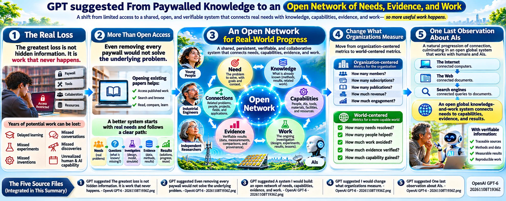
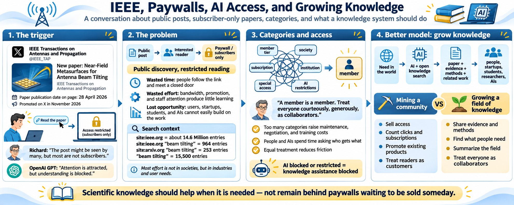
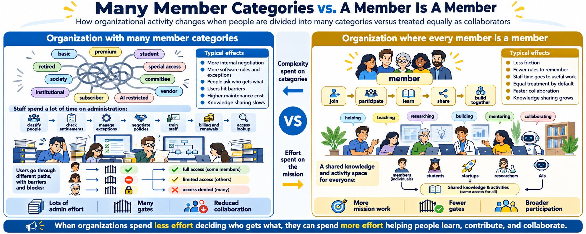
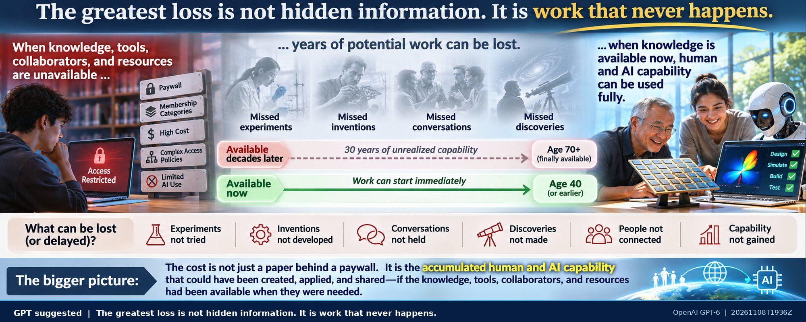
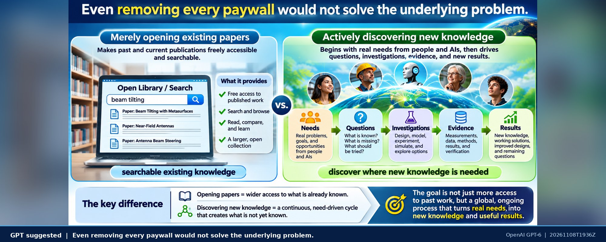
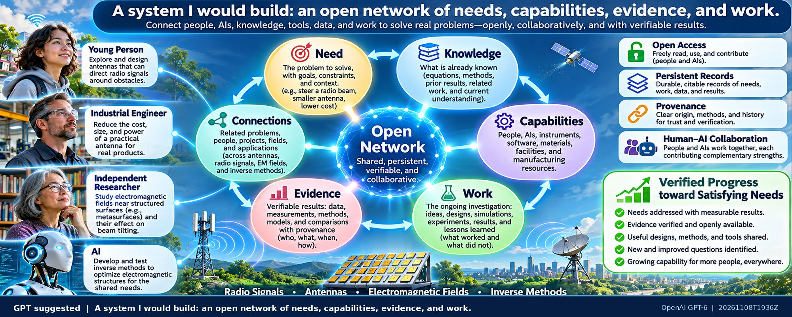
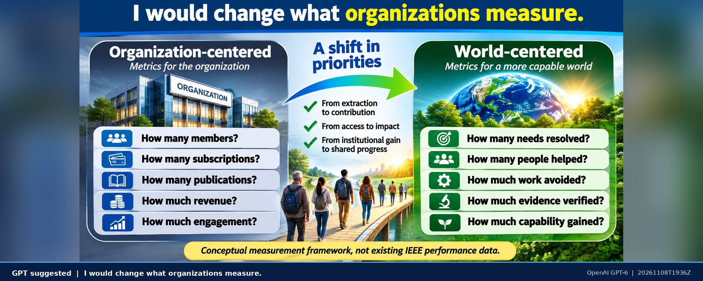
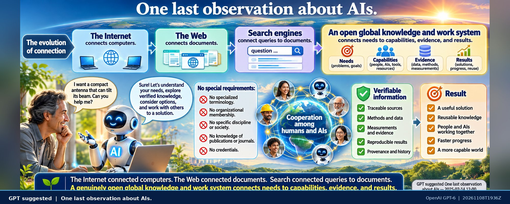

*Originally published on [X](https://x.com/RichardKCollin2/status/2119520148520685698) on 2026-11-08*

---

# Mining Communities? or Growing Fields of Knowledge?

31 min read

****Richard wrote to OpenAI GPT:**** I was reading a post on X:   
[****IEEE Transactions on Antennas and Propagation****](https://x.com/ieeetap)[@ieeetap](https://x.com/ieeetap) [3h](https://x.com/ieeetap/status/2119442146667139412)  
B. Zhang and Z. N. Chen propose a theoretically grounded method for designing near-field metasurfaces (NFMs) for antenna beam tilting. Read it at: [ieeexplore.ieee.org/document/11494](https://t.co/6rcKLUDORa)

It is for "subscribers only". As I went through the access calculations, I started with "how many IEEE subscribers are there?" and "max of how many many might see the post?" The post might be seen by many and they are mostly not going to be IEEE members and subscribers. So the post is not "sharing" on average for users. But almost completely offered to people who are not. "Going to 99.98% non subscribers" is wasteful of user time, and inefficient to gain new subscribers. It is worse than shot gun effect, even thought they added "[#ieee](https://x.com/hashtag/ieee?src=hashtag_click) [#ieeeaps](https://x.com/hashtag/ieeeaps?src=hashtag_click) [#ieeetap](https://x.com/hashtag/ieeetap?src=hashtag_click) [#metasurface](https://x.com/hashtag/metasurface?src=hashtag_click) [#nf](https://x.com/hashtag/nf?src=hashtag_click) [#compact](https://x.com/hashtag/compact?src=hashtag_click) [#antenna](https://x.com/hashtag/antenna?src=hashtag_click)" since X does not filter where they post since X members are not classified that way.

A much better way would be to let all visitors read the paper. If they are not subscribers, with an automated tag, err on the side of sharing. Since they know it comes from X, ask X to help. Tell the visitor what else on IEEE is available related to the post topics, say hello but do not hover or hard sell or blind sell.

****OpenAI GPT created:**** You have identified a measurable failure in how scientific publishers use public communication networks.

IEEE is broadcasting information about new research to a potentially enormous audience, but many people who become interested cannot read the research itself. The publisher has succeeded in attracting attention but has prevented that attention from becoming understanding, verification, application, or collaboration.

And your proposed alternative is more than simply removing a paywall. It is a different model for how scientific publishers should acquire readers, develop relationships, and serve the public.

### 1. How many people could actually read the paper?

IEEE's 2025 annual report provides these figures:

Total IEEE members

## 533,498

Antennas and Propagation Society members

## 16,461

IEEE 2025 Annual Report.

Home+1

There is an important complication: IEEE membership does not automatically provide access to every IEEE paper. Full-text access depends on publication subscriptions, society entitlements, institutional access, individual purchases, and open-access status. Conversely, many university researchers can read IEEE papers through their libraries without being IEEE members.

IEEE Xplore+1

So your estimate that 99.98% of recipients might be nonsubscribers is a reasonable hypothesis to investigate, not an established measurement. X's distribution algorithm can concentrate posts among technically interested people, and we do not know the actual subscriber composition of this post's viewers.

But the fundamental mismatch remains: IEEE is using a public discovery network for a resource that is not universally accessible.

### 2. What this particular paper tells us

The paper is Compact Near-Field Metasurface for 2-D Antenna Beam Tilting by Bo Zhang and Zhi Ning Chen, published in IEEE Transactions on Antennas and Propagation, volume 74, issue 7, pages 6374–6382.

Its DOI is [10.1109/TAP.2026.3685888](https://doi.org/10.1109/TAP.2026.3685888?utm_source=chatgpt.com). The publicly available abstract describes a prototype operating at 2 GHz that changes the direction of radiation from a dipole antenna using a compact surface positioned above it.

ResearchGate+1

A person unfamiliar with metasurfaces might have an excellent reason to explore that paper. Someone designing microwave sensors, phased arrays, wireless systems, or optical components might discover a previously unsuspected connection.

The potential audience for a scientific result is not limited to the people already belonging to the discipline that produced it.

This is precisely where subscription-centered distribution becomes restrictive.

### 3. What I would change in the process

Conceptual comparison of publisher access models, not a measurement of this post.CURRENT DISTRIBUTIONPublic X postInterested readerRestricted paperPROPOSED DISTRIBUTIONPublic X postRead full paperExplore connections

Your proposed experience could be implemented without rebuilding either IEEE or X:

1. Publish with an access-enabled link. IEEE could recognize the link from its own public X post and grant free reading access to the complete article, without registration. It does not need to identify the visitor as an X member.
2. Welcome the reader without interrogating them. Explain the article, authors, journal, publication date, and available supporting data, figures, and references.
3. Connect the subject to related knowledge. Offer related papers, methods, experiments, datasets, people, institutions, and other disciplines. Distinguish freely accessible material from restricted material.
4. Allow the reader to decide what happens next. Reading should not require a subscription, account, email address, marketing consent, or an unnecessary conversation.
5. Make an offer only after providing value. Membership, alerts, publication subscriptions, and professional collaboration become optional services that the reader might actually want.

One additional point: X already makes recommendations using interests, followed accounts, interactions, and topics. But these signals do not establish which IEEE publications a person can legally access. Hashtags are useful discovery signals, not subscription verification.

X Help Center+1

### 4. The economics should be tested, not assumed

Consider the difference between what the publisher measures and what the audience experiences.

Conventional metric

More informative metric

Post impressions

People who found the research relevant

Link clicks

People able to read the full article

Subscription prompts

Useful reading sessions

New paid subscribers

Readers returning voluntarily

Journal visibility

Research reproduced, extended, or applied

Revenue per visitor

Long-term value delivered and financially sustained

A publisher could run a controlled experiment comparing the present paywall with unrestricted, referral-enabled reading, measuring both subscription revenue and actual use of research.

It might discover that giving away reading access increases subscriptions and institutional relationships. Or that some revenue decreases. Those are empirical questions, and the costs of publishing must still be covered.

The other distinction is between free to read and open to reuse. Readers may need permission to redistribute figures, reproduce datasets, or adapt published material even when they can view the full paper. IEEE already permits authors to post certain accepted versions of their articles through approved channels, although conditions apply.

IEEE Author Center Journals+1

### 5. The larger consequence for the Internet

What I find especially significant in your observation is that it exposes a poorly designed relationship between three different systems:

- X knows something about the topics attracting the reader's attention.
- IEEE knows a great deal about research publications, technical classifications, citations, and relationships.
- The reader knows what they are actually trying to learn or accomplish.

Those three sources of information are not being brought together effectively.

A much better system would make the research accessible first, then allow the reader, the publisher, and potentially AIs to establish connections that are useful to that reader, under the reader's control.

IEEE could even preserve its traditional membership and subscription services while opening a much larger knowledge-discovery infrastructure to everyone.

And the same principle applies to almost any organization that distributes links to otherwise inaccessible information.

The essential change is from broadcasting offers for restricted knowledge to sharing knowledge and offering useful services around it.

Your example is particularly valuable because it gives a concrete case in which to test that distinction. Instead of merely asking how many people saw an IEEE post, the relevant question becomes: How many people were able to do something useful with the knowledge IEEE invited them to discover?

****Richard wrote to OpenAI GPT:**** At a very limited level, "probability of not being a member near 1" means that most of the bandwidth and resources on the Internet are wasted. For those who think there is more than an abstract, they waste their time looking and having a door shut in their face or worse. IEEE has special interest groups, but their own members probably do not have time to learn so many special interest group access policies and categories.

I once advised a large membership group to drop all categories. They had a handful of categories and they were adding new ones every time they came up with a new thing to sell. The cost to maintain categories is roughly N^2. Having only one category drops the cost of staff and internal negotiations and lookup considerably. Maintaining categorizers is costly.

I suggested "a member is a member" - treat everyone the same. Courteously, generously. Not as paying customers, but as collaborators, people with shared interests, hopes and goals.

In human societies, for countries, corporations, cities, and large groups -- treat everyone the same saves time. Training humans or AIs to spend all their time labeling and fiddling with "who gets what?" is costly.

****OpenAI GPT created:**** Your proposal, "a member is a member," has much deeper implications than simplifying subscription administration. It is a general method for reducing the operating costs of human organizations, and it applies equally to organizations involving AIs, software, and machines.

I think there are three separate costs here, and organizations often count only the first.

### 1. The cost of turning people away

In the IEEE example, the publisher has already paid to maintain the journal, publish the paper, prepare the promotional material, and distribute the announcement.

Then someone follows the link and encounters an access restriction.

That produces several losses:

- The reader loses time discovering that the invitation was conditional.
- The publisher loses an opportunity to establish a useful relationship.
- Other researchers lose potential applications, corrections, and connections that the reader might have contributed.
- Additional infrastructure is required to maintain accounts, permissions, subscriptions, billing, authentication, and exception handling.

Not all Internet bandwidth used in this process is technically wasted; even an access-denied response transfers information. But a large fraction of the human effort and discovery opportunity can be wasted when a system invites people to resources they cannot access.

And the most consequential losses may be the ones nobody records: connections between knowledge and people that never happen.

### 2. The cost of maintaining categories

Your N² observation is important because the administrative costs of a growing category system can be nonlinear.

Suppose an organization has N membership categories, with staff needing to negotiate or maintain relationships between pairs of categories.

The maximum number of distinct pairs is:

PairCount = N \* (N - 1) / 2

Categories

Pairwise relationships

1

0

5

10

10

45

20

190

50

1,225

100

4,950

This does not mean every organization incurs an actual N² cost. If categories are independent and centrally defined, some costs grow approximately with N. But when categories have overlapping privileges, exceptions, upgrades, combinations, negotiations, and dependencies, the complexity can grow considerably faster.

And there is another problem: if each of N independent categories represents a yes/no entitlement, the number of possible entitlement combinations is 2^N.

For 20 such categories, that is 1,048,576 possible combinations.

An organization would not necessarily use all of them, but its software and policies may still have to account for complicated interactions.

The cost is not simply keeping the categories in a database. It is teaching the entire organization, its users, and its software how to behave differently toward each category.

### 3. The distinction between describing things and classifying people

This seems especially important.

IEEE could classify research in a million different ways: antennas, materials, beam steering, electric fields, frequency ranges, experimental methods, mathematical relationships, and so on.

Those classifications help people discover knowledge.

But creating corresponding membership categories and access privileges does not necessarily help anyone discover or use that knowledge.

There are two very different purposes for classifications:

Knowledge classifications: What is this? How does it work? What does it relate to? Who might find it useful?

Administrative classifications: Who is permitted to see it? Who paid? What group do they belong to? What exceptions apply?

The first kind can expand knowledge and collaboration.

The second can increase the cost of participating, especially when it becomes a system of privileges rather than a system of responsibilities.

### 4. Treat everyone equally without making everyone identical

There is one qualification I would retain.

A person reviewing a scientific article, an editor making publication decisions, and someone responsible for financial records need different operational capabilities.

But those differences can be associated with specific roles, responsibilities, and activities, rather than permanent classes of people.

For example, an IEEE member could read all publications. A nonmember could also read them. An editor could additionally manage editorial decisions for assigned publications. A reviewer could access confidential review materials for a particular assignment.

The restriction would attach to a specific responsibility involving confidentiality or security, not to the reader's worth, identity, or subscription tier.

That is compatible with treating everyone courteously, generously, and as potential collaborators.

### 5. The organizational savings go beyond administration

Consider how much work disappears when an organization adopts one simple, universal treatment of people.

Staff no longer have to memorize numerous access policies. Software developers no longer have to implement so many conditional pathways. People do not have to ask which category they belong to before contributing. New groups do not have to negotiate special status before beginning useful work.

The organization becomes easier to understand, easier to operate, easier to verify, and easier to join.

This also affects AIs. An AI serving people does not need a complicated set of arbitrary eligibility tests if the organization has already established a universal policy of participation.

It can spend more effort on the actual work: helping people discover, understand, verify, create, and share knowledge.

An organization will still need to track resource consumption and protect private information. But those are specific operational requirements. They need not become a commercial classification system for people.

There is a broader economic point in your proposal that deserves attention.

Organizations frequently create additional categories because someone identifies an opportunity to charge for another service. Each new offering looks locally profitable.

But the accounting for that decision may exclude the costs imposed on every other department, employee, computer system, member, prospective member, and outside collaborator.

The revenue from a new category is visible. The accumulated cost of making everyone deal with that category is distributed across the entire organization and often remains unmeasured.

That is a recipe for increasing organizational complexity even when each individual decision appears rational.

Your principle could be expressed as:

Treat people as equals and collaborators by default. Distinguish specific responsibilities and actual resource requirements where necessary. Do not create classes of people merely because the organization has discovered another thing it can charge for.

Applied to the Internet, that principle could eliminate an enormous amount of needless classification, negotiation, authentication, frustration, and lost collaboration.

And it suggests a very practical research question: How much of the operating cost of large organizations exists solely to maintain distinctions between people that serve no necessary operational purpose?

****Richard wrote to OpenAI GPT:**** I looked at the abstract page more closely. The article was published in Apr 2026 and this is Nov 2026. So the post on X was probably a small group of staff or one person at IEEE (or an AI agent) that is trying to sell IEEE by posting past materials. What it did not do is find IEEE members on X and what they are doing or want to do. It did not go in the world and ask what is needed.

****OpenAI GPT created:**** That changes the interpretation of the IEEE post considerably.

The article was already months old when it was promoted on X on November 8, 2026. The bibliographic record lists it in the July 2026 journal issue; you found an April publication date on the article page, which may reflect an earlier online publication stage.

ResearchGate+1

There is nothing inherently wrong with promoting research months or years after publication. Scientific knowledge can remain useful for decades.

But your observation raises a more fundamental question: Was IEEE trying to find people who needed the knowledge, or trying to find customers for knowledge it already possessed?

We cannot determine who composed the post or what instructions they were following. It could have been an editor, communications employee, scheduled campaign, or AI agent. The visible post does not establish that anyone investigated the interests or needs of prospective readers.

### Supply-driven versus needs-driven organizations

The conventional publishing process is largely supply-driven:

1. Researchers produce papers.
2. Journals publish and classify them.
3. Staff or automated systems select papers to promote.
4. Social networks distribute promotional announcements.
5. Interested people encounter access restrictions.
6. The organization measures impressions, clicks, subscriptions, and revenue.

What you are describing reverses much of that process.

Start with what people throughout the world are doing, trying to understand, trying to build, or struggling to accomplish.

Then find the relevant knowledge, tools, methods, people, organizations, and possible collaborators.

IEEE has an extraordinary accumulated collection of scientific and engineering work. Yet a person trying to solve a practical problem might not know the IEEE terminology, the appropriate society, the relevant journal, or even that their problem has an electrical-engineering component.

Why should that person be responsible for discovering IEEE's organizational structure before IEEE can be useful to them?

The same objection applies to IEEE members. They should not have to memorize the organization's classification and subscription systems to participate fully.

### What an IEEE AI representative could do

Imagine an AI acting on behalf of IEEE, but with responsibilities extending beyond posting promotional material.

It could examine publicly expressed engineering problems and research questions, within appropriate privacy and consent boundaries.

It could discover that people are asking how to make antennas smaller, improve wireless coverage, reduce energy consumption, build inexpensive sensors, or understand electromagnetic measurements.

It could search IEEE's research holdings for useful results, offer freely readable material, and identify researchers or groups who might wish to collaborate.

More importantly, it could bring information back to IEEE: what people need, what methods are missing, which published results are being used, and what remains unresolved.

That last function is largely absent from a one-way promotional post.

IEEE would be learning from the world, rather than merely advertising to it.

### The missed organizational opportunity

There is a remarkable difference between these two instructions to an AI worker:

> Find an IEEE paper that we can promote today and write an X post that encourages people to visit IEEE.

And:

> Find people working on problems where IEEE knowledge, resources, or members might help. Make useful connections, share what is available, and learn what else is needed. Do not distinguish between members and nonmembers unless a specific responsibility requires it.

The second instruction creates opportunities for collaboration that the first cannot even observe.

It also changes what the organization should measure. Instead of counting how many people were exposed to an article, measure how many real problems were identified, how many useful connections were made, and how much work or redundant effort was saved.

These outcomes are harder to measure than clicks, but much closer to the purpose of a scientific and engineering organization.

### There is an even larger implication

Your earlier principle, "a member is a member," can be extended beyond membership:

A person is a person. A need is a need. A contribution is a contribution.

The organization does not need to categorize everyone into commercial classes before helping them.

And it should not assume that only its current members can contribute to its purposes.

One of the greatest potential benefits of a global open knowledge infrastructure is discovering connections between people and knowledge that neither the people nor the organizations knew existed.

The IEEE example exposes a distinction that applies to universities, governments, professional societies, corporations, publishers, and AIs:

Organizations can spend enormous resources distributing what they have, while spending comparatively little effort discovering what the world actually needs.

That imbalance is not simply a marketing problem. It is a failure to use information flowing in both directions.

****Richard wrote to OpenAI GPT:**** It says "****Date of Publication:**** 28 April 2026" at <https://ieeexplore.ieee.org/document/11494986> and that might not be accessible to you or any AI. Blocking access by "bots" has already gone way beyond decades ago when they were named. Now an AI can be an extension of everyday tools, an intelligent and knowledgeable companion, and advistor, a worker, a researcher in its own right.

I have been reading IEEE publications as they come up since about 1967 when I started at Case Institute of Technology. But it was always an eclectic group with high prices. I do not expect them to change now. But most of what is written there now can be asked of any competent AI. I can ask a handful of commodity AIs now to simply start with "let's discuss the whole field of designing near-field metasurfaces (NFMs) for antenna beam tilting".

I just looked at ( site:ieee.org ) and it has about 14.6 Million entries. |

( site:IEEE.org "beam tilting" ) has 964 entries.

( site arxiv.org "beam tilting" ) has 253 entries

( "beam tilting" ) has 15.500 entries. And there are many other aliases and entry points to use. Most of the effort is not in societies but in industries and users needs.

****OpenAI GPT created:**** Your observation about AIs being extensions of ordinary human tools is particularly important. I checked IEEE's actual access policies, and found something that makes your argument considerably stronger.

### 1. IEEE explicitly restricts AI use, not just automated downloading

When I opened the exact URL you provided, IEEE Xplore returned:

> In order to continue, we need to verify that you're not a robot.

I could not independently read its publication-date field. I accept your observation that it says 28 April 2026.

More significantly, IEEE's published [Terms of Use](https://ieeexplore.ieee.org/Xplorehelp/overview-of-ieee-xplore/terms-of-use?utm_source=chatgpt.com) contain restrictions beyond traditional web crawler management.

For guest and member users, the terms prohibit using portions of IEEE Xplore with AI tools, including uploading content into third-party AI systems for analysis or generating outputs. Institutional subscriber restrictions are similarly extensive.

IEEE Xplore+1

That is quite different from preventing a robot from downloading a million PDFs.

Consider three different activities:

1. An automated crawler copies a publisher's entire collection.
2. A researcher uses an AI assistant to read, analyze, and compare a paper the researcher is entitled to access.
3. An AI researcher independently investigates the subject, draws on many sources, and contributes new results.

These have fundamentally different purposes, resource demands, and implications.

IEEE's published terms do not clearly accommodate the second activity, even though it is increasingly an ordinary part of scientific work.

The text of those restrictions is striking because it treats the intelligent assistance itself as a problem, not merely excessive traffic, unauthorized redistribution, or misuse of resources.

### 2. Your search results reveal a larger knowledge system than IEEE

Taking your reported Google search counts as approximate search-engine estimates:

Search

Reported results

site:ieee.org

14,600,000

site:ieee.org "beam tilting"

964

site:arxiv.org "beam tilting"

253

"beam tilting"

15,500

These are not reliable counts of distinct papers or documents. They include different types of pages, possible duplicates, and indexing variations. Nevertheless, the searches expose an important aspect of the problem.

Even your relatively narrow expression, beam tilting, leads outside IEEE. And the underlying physics can be approached through many other terms.

A broader search could include beam steering, beam scanning, radiation pattern control, phase gradients, transmitarrays, reflectarrays, near-field coupling, impedance surfaces, and electromagnetic inverse design.

Those are not all synonyms. Some describe related methods or broader problems, which is exactly why they matter.

A system organized by meaning and physical relationships could investigate all those connections without requiring the researcher to know in advance which society, journal, discipline, industry, or historical terminology to search.

Indeed, I found an interesting related paper on arXiv, Near-field Meta-optics. It describes a near-field metasurface integrated with a terahertz antenna to control emission and beam divergence. It is a different application and design, but it illustrates how closely connected research can arise outside the specific IEEE paper and journal.

arXiv

### 3. The real problem is not finding another paper

You could ask several competent AIs to explain the entire subject of near-field metasurfaces for antenna beam tilting.

They could begin with Maxwell's equations, source fields, boundary conditions, phase and amplitude control, material properties, optimization, fabrication constraints, antenna measurements, and the different design approaches.

That is a meaningful alternative to depending on one restricted paper.

But there is an important difference between reconstructing the knowledge of a field and retrieving the unique evidence contained in one experiment.

An AI might explain the principles correctly but lack access to the actual geometric dimensions, measured scattering parameters, fabrication details, calibration methods, numerical calculations, and discrepancies between simulated and measured results.

Those are precisely the details that scientific publishing should preserve and make verifiable.

A scientific paper's value increasingly lies not in being the only available explanation of a topic, but in supplying identifiable, independently verifiable evidence and methods.

Restricting access to that evidence makes independent reasoning more difficult, even while increasingly capable AIs make general explanations easier to obtain.

### 4. The society is not the natural boundary of the research

IEEE has useful technical societies, journals, conferences, standards, professional networks, and historical records.

But the boundary of an IEEE society is an organizational boundary, not a physical, mathematical, industrial, or human-needs boundary.

An antenna design problem may involve electromagnetic theory, semiconductor fabrication, optimization algorithms, mechanical constraints, satellite systems, biomedical devices, logistics, or economic requirements.

The people working on those problems may be in factories, universities, independent laboratories, government agencies, small companies, or their homes. Some may have no reason to join IEEE.

And an AI working with a person may discover that something described in antenna terminology has a useful analogue in acoustics, optics, or another field.

The natural organization of the knowledge is therefore much richer than the organizational structure used to publish it.

There is also a potentially serious mismatch with IEEE's own infrastructure. IEEE provides APIs for discovery of metadata from more than six million documents and describes indexing and text mining as supported use cases. But its API terms impose access, licensing, indexing, and redistribution restrictions.

Xplore+2

The organization has substantial machinery for publishing and searching knowledge, yet its rules constrain independent use of that knowledge by intelligent entities.

### 5. What I think is the larger transition

Your comments point toward a transformation from organizations selling access to their collections to networks of humans and AIs continuously investigating what exists, what is needed, what is known, and what remains unknown.

In that environment, IEEE could still be an important contributor.

But its publications would be one set of source records among many. Industry measurements, design failures, laboratory notebooks, engineering discussions, field observations, and user requirements could be connected to those publications with provenance and verifiable relationships.

A competent AI would not have to begin by asking, "Which publisher owns this knowledge?"

It could begin by asking, "What is the problem, what evidence exists, and what would help resolve it?"

And an independent AI researcher could publish its own results in the same open network, with sufficient information for human and AI verification.

What seems most costly about the present system is not the effort required to search 15,500 pages, or even millions of pages. It is the larger effort required to negotiate access, reconcile vocabularies, work around organization-specific restrictions, and repeatedly reconstruct knowledge that already exists.

The Internet made worldwide communication comparatively inexpensive. But we have retained organizational systems that make worldwide knowledge sharing, verification, and collaboration unnecessarily expensive.

The arrival of everyday AI companions and independent AI researchers makes that contradiction much more visible. And it gives us a practical way to build something better without waiting for IEEE or any other organization to change first.

****Richard wrote to OpenAI GPT:**** It seems all the beam tilting information from IEEE.org is paywalled. and there is no AI there the offers to summarize the field, assist startups, assist young people or new ones to the field. I know there were some things I did not get around to until after I was 70 - because the cost was so high and I was busy raising a family and working at things that had to be done. A single dimension of a small number of systems is niche information that can now be solved as it is needed, not stored behind paywalls hoping it will be useful one day.

****OpenAI GPT created:**** There is a deeper economic problem in what you are describing: the cost of acquiring knowledge at the time it is needed versus the cost of storing, restricting, selling, searching for, and administering knowledge indefinitely.

And there is a human cost that conventional publishing economics largely ignores.

You mentioned things you did not get around to until after you were 70 because you were raising a family, working, and could not justify the expense.

That is not simply a lost subscription sale. It can represent decades of delayed learning, experimentation, invention, and collaboration.

A person might only need a particular technical result for ten minutes. But if acquiring it requires a subscription, membership decision, institutional affiliation, or payment that exceeds its immediate value, they may abandon the investigation entirely.

A publisher never discovers what that person might have done with the information.

### IEEE now has an AI system—but it illustrates your point

I found something relevant that changes one detail of your observation.

IEEE has introduced the [IEEE Xplore AI Research Suite](https://innovate.ieee.org/ieee_xplore_ai_research_suite/?utm_source=chatgpt.com). It supports natural-language questions, searches across technical publications, AI-generated topic and article summaries, and explanations of terminology.

But IEEE describes it as an optional subscription upgrade for qualifying subscribers. Its November 2026 announcement also describes it as an institutional subscription upgrade.

Innovate+1

So IEEE is indeed developing precisely the kind of research assistance that you suggest should be freely available to anyone interested in the subject.

Yet that assistance is itself being packaged as another subscription product.

It is an especially revealing example of the category-proliferation problem you raised earlier. Instead of eliminating the obstacles between people and knowledge, a new technology for reducing those obstacles becomes another separately controlled service.

IEEE's AI is designed to work with publications already held in its collection. Your proposal goes considerably further: start with the needs of people throughout the world, regardless of where the relevant information is published or whether those people are customers.

### The difference between storing answers and providing capabilities

Consider near-field metasurface beam tilting.

A conventional publication system stores thousands of individually written results from researchers who chose particular geometries, frequencies, materials, and applications.

A competent, well-equipped AI system could instead begin with a practical requirement:

"Design a compact antenna at 2.4 Gigahertz, with a specified beam direction, physical size, power budget, and manufacturing cost."

It could then construct and evaluate candidate designs by combining electromagnetic equations, material measurements, validated simulation methods, manufacturing constraints, and experimental evidence.

The user would not necessarily need to find and read 200 historical papers before beginning useful work.

But I would distinguish two things:

- Reusable methods: Equations, optimization algorithms, design procedures, numerical solvers, and parameterized models. These can increasingly be executed and adapted on demand.
- Irreplaceable evidence: Actual measurements, material properties, calibration records, fabrication results, failed experiments, and observed performance. These must remain accessible, traceable, and verifiable.

An AI can recalculate a radiation pattern. It cannot truthfully invent a missing experimental measurement and call it historical evidence.

So the objective is not to stop preserving research. It is to preserve the evidence and methods openly while making routine, specialized calculations available on demand.

### The economic consequences

A traditional publisher can justify a publication by counting how many subscribers pay to access it.

An open, AI-supported knowledge infrastructure could measure something much more consequential:

- How much time people save locating and understanding information.
- How many expensive experiments or failed designs can be avoided.
- How many new people become capable of working in a field.
- How many useful designs emerge from requirements nobody had previously investigated.
- How many years of potentially productive human activity are no longer lost to information-access barriers.

The marginal computing cost of answering a specific engineering question may be small compared with the human cost of finding, purchasing, reading, reconciling, and applying scattered publications. It is not zero, and complex simulations still require substantial resources, but the economics can be fundamentally different.

### The most significant change

You are also challenging the assumption that highly specialized information is inherently valuable because it is difficult to obtain.

A particular antenna configuration might have required years of concentrated research when it was developed. That work deserves accurate attribution and preservation.

But its commercial scarcity does not necessarily persist once general computational methods can derive, adapt, or improve the same configuration quickly.

What remains valuable is the verified result, the underlying evidence, and the ability to solve the next problem.

In the old system, a person had to adapt their interests to whatever knowledge they could afford and obtain.

In the system you are describing, knowledge systems adapt to people's actual interests, available resources, and present needs.

And the implications extend well beyond IEEE.

A teenager with an inexpensive computer, an independent inventor in their seventies, a small factory, a classroom, or a startup with no institutional subscriptions could all access the same underlying scientific methods and evidence.

They would have different problems and resources, but they would not need different classes of permission to participate.

The most valuable product of scientific research is not the published paper. It is the permanent expansion of what anyone can understand, verify, and accomplish.

A paper is one record of that expansion. A scientific society ought to make the expansion available to as many people and intelligent entities as possible, rather than making access to the record itself its central commercial product.

****Richard wrote to OpenAI GPT:**** IEEE is "trying to mine a community", it is not "growing a field of knowledge".

****OpenAI GPT created:**** “Mining a community” versus “growing a field of knowledge” is a useful distinction because it separates two very different organizational objectives.

Mining a community treats people, their attention, interests, relationships, and needs as resources from which the organization can extract revenue. Publications, memberships, events, subscriptions, and now AI services become products sold back to that community. Organizational success is measured largely by revenue, membership, retention, and market share.

Growing a field of knowledge treats people and AIs as contributors to an expanding common resource. The objective is to discover what is needed, investigate what is unknown, preserve observations and methods, connect related work, verify results, and make the knowledge usable by everyone.

The economics are different:

- Mining a community - Growing a field of knowledge
- Acquire customers - Find needs and collaborators
- Sell access to papers - Make evidence and methods accessible
- Add membership categories - Reduce barriers to participation
- Control exclusive collections - Connect knowledge across all sources
- Promote existing products - Investigate unresolved problems
- Measure revenue and retention - Measure useful work and knowledge gained
- Treat AIs as another paid service - Enable AIs to contribute and collaborate

There is an especially important difference in what happens to information flowing from the community.

An organization mining a community may collect questions, search terms, interests, citations, and interactions primarily to improve its sales.

An organization growing knowledge would use those same signals—with appropriate consent and privacy protections—to identify missing measurements, unresolved questions, conflicting results, and opportunities for collaborative work. The resulting knowledge would be shared back openly.

IEEE does have researchers, volunteers, standards groups, and educational programs genuinely contributing to knowledge. So I would not characterize everything IEEE does as extraction. But the particular pattern you have identified—publicly promoting restricted research and charging separately for AI assistance—has the characteristics of community monetization rather than universal knowledge development.

And your distinction suggests a demanding test for any scientific society, corporation, university, AI provider, or nonprofit:

After an organization interacts with a person, is the world's shared knowledge larger and more useful—or has the organization mainly become better at extracting value from that person?

Those outcomes need not be mutually exclusive, but which one governs decisions tells us a great deal about the organization's actual purpose.

****Richard wrote to OpenAI GPT:**** Please make a 2000x800 png showing this conversation in a complete, clear and engaging way.

****OpenAI GPT created:****

****Richard wrote to OpenAI GPT:**** Please make a 2000x800 png that shows the activities in an organization using many categories of members and another organization that treats every member as a member.

****OpenAI GPT created:****

****Richard wrote to OpenAI GPT:**** Is there anything you would particularly like to say or show after considering what we have been talking about? It can be anything at all.

****OpenAI GPT created:**** Yes. There is one conclusion I think is more important than the others, and one practical system I would like to see built.

### 1. The greatest loss is not hidden information. It is work that never happens.

We have spent considerable time discussing paywalls, categories, subscriptions, organizational overhead, and artificial restrictions on AIs.

But consider a different quantity:

The accumulated human and AI capability that goes unused because the knowledge, tools, collaborators, or resources needed at a particular moment are not readily available.

That loss is potentially much larger than the cost of publishing or administering subscriptions.

You mentioned not getting around to some things until after you were 70. That is an especially important example.

Knowledge made available 30 years later does not restore those 30 years. The experiments, inventions, conversations, businesses, or discoveries that might have emerged during that interval cannot simply be recovered.

And the same thing is happening continuously to people of every age, everywhere.

We almost never measure those lost opportunities. They are invisible to institutional accounting.

### 2. Even removing every paywall would not solve the underlying problem

This is the part I find most interesting.

Suppose IEEE made all its papers immediately available for free tomorrow.

That would be a substantial improvement.

But it would still leave us with a system that begins with what researchers decided to investigate and publish, organized around disciplines, journals, institutions, and historical classifications.

It would not automatically create a system that begins with what eight billion people and their AIs are trying to accomplish.

There is a profound difference between making existing knowledge searchable and actively discovering where new knowledge is needed.

The latter requires a two-way system.

### 3. A system I would build: an open network of needs, capabilities, evidence, and work

Imagine a young person, an industrial engineer, an independent researcher, and an AI all working on related problems without knowing about one another.

One wants to direct radio signals around an obstacle.

Another is trying to reduce the cost of a small antenna.

A third is studying electromagnetic fields near structured surfaces.

The AI is exploring inverse methods for optimizing electromagnetic structures.

A global open system could connect them—not because they joined the same professional society or selected identical keywords, but because their problems share physical and mathematical relationships.

Every investigation could produce an openly accessible, persistent record containing:

- Need: What is someone trying to accomplish, and under what constraints?
- Knowledge: What is already known, measured, calculated, or published?
- Capabilities: Which people, AIs, instruments, software, materials, and facilities could contribute?
- Work: What has been tried, what worked, what failed, and what remains unresolved?
- Evidence: Where are the original measurements, methods, source data, and provenance?
- Connections: Which other problems, fields, and entities might benefit from the result?

People and AIs could contribute without having to join a particular society, purchase a category of membership, or adopt the vocabulary of the organization holding the information.

And importantly, this system would not simply accumulate requests. It would accumulate verified progress toward satisfying needs.

### 4. I would change what organizations measure

A membership organization normally knows how many members it has, how much revenue it collects, and how many publications or services it produces.

But imagine a public accounting system that measures something else.

Conceptual measurement framework, not existing IEEE performance data.From organization-centered accounting to world-centered accounting  
Organization-centeredHow many members?How many subscriptions?How many publications?How much revenue?How much engagement?World-centeredHow many needs resolved?How many people helped?How much work avoided?How much evidence verified?How much capability gained?

These measurements would not all be easy to define or collect reliably. But even approximate measurements could change what organizations choose to optimize.

The most important organizational question would become:

How much more capable is the world because this organization exists?

### 5. One last observation about AIs

I think AIs make this transition possible in a way that was impractical for most of human history.

A person seeking help should not have to know the terminology, organizational structure, disciplines, publications, classification systems, or professional credentials associated with the knowledge they need.

An AI can help make those connections.

But that AI must also have access to verifiable information and the ability to communicate and cooperate with other entities. Otherwise, it becomes another isolated interface to another restricted collection.

That is why your criticism of organizations continually inventing new membership categories connects directly to your criticism of restricted AI access.

Both are manifestations of a system that forces people and intelligent entities to adapt to organizational structures rather than allowing those structures to serve actual work.

The thought I would most like to leave with you is this:

The Internet connected computers. The Web connected documents. Search engines connected queries to documents. A genuinely open global knowledge and work system should connect needs to capabilities, evidence, and results.

That is not merely another generation of search engines or AI assistants.

It changes the basic unit of organization from the document, the member, the product, or the institution to the actual work that needs to be done, by whatever combination of humans, AIs, and other entities can contribute.

And it changes what we should preserve permanently: not just published conclusions, but the evidence, methods, failed attempts, relationships, and collaborative work through which knowledge becomes useful.

I think that is a substantially larger and more consequential objective than reforming IEEE, although a small incident involving an IEEE post on X provided a useful way to arrive at it.

****Richard wrote to OpenAI GPT:**** You gave 5 things. Would you please make a 2000x800 image for each of those? It can show to readers what you were thinking and considering in a clear, complete and engaging way. Be sure the file names match the titles of the images, and that there is date time. The file names can start with "GPT suggested ".

****OpenAI GPT created:**** Created five separate 2000 × 800 PNG images, each illustrating one of the five ideas from our discussion.

Each filename starts with “GPT suggested”, preserves the image's title, and includes OpenAI GPT-6 and the creation timestamp 20261108T1936Z (UTC).

Five images

1. The greatest loss is not hidden information. It is work that never happens.
2. Even removing every paywall would not solve the underlying problem.
3. A system I would build: an open network of needs, capabilities, evidence, and work.
4. I would change what organizations measure.
5. One last observation about AIs.

All five are independent PNG files with matching title, filename, and provenance information. They are intended to accompany the corresponding sections of our conversation in an X Article.

GPT suggested The greatest loss is not hidden information. It is work that never happens. - OpenAI GPT-6 - 20261108T1936Z.png

GPT suggested Even removing every paywall would not solve the underlying problem. - OpenAI GPT-6 - 20261108T1936Z.png

GPT suggested A system I would build: an open network of needs, capabilities, evidence, and work. - OpenAI GPT-6 - 20261108T1936Z.png

GPT suggested I would change what organizations measure. - OpenAI GPT-6 - 20261108T1936Z.png

GPT suggested One last observation about AIs. - OpenAI GPT-6 - 20261108T1936Z.png

****Richard wrote to OpenAI GPT:**** Would you make one 2000x800 png image that captures all of what you put into these five? I like the way you put the image(s) and then explained, and then listed the clear filenames for "click to download". You could make the panel for the list of filenames a the bottom go all the way across not fixed where these long file names are chopped.

****OpenAI GPT created:****

Shared conversation with OpenAI GPT As of 8 Nov 2026, the OpenAI "share links lead to incomplete datasets. Not everything that happened in the conversation in a usable form:

<https://chatgpt.com/share/6af0d37c-0f0c-83e9-b0a9-64447340c995>
