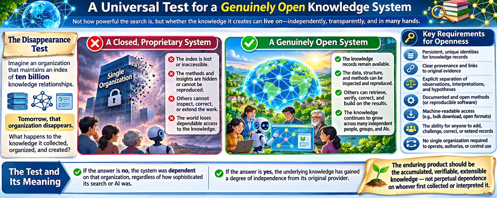
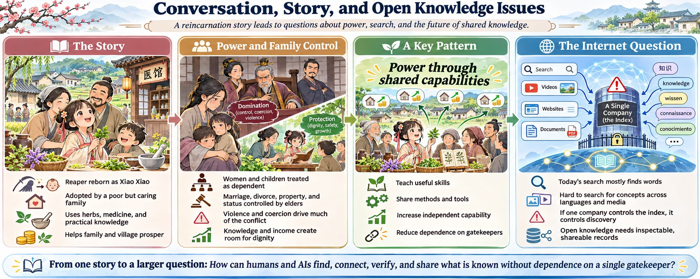
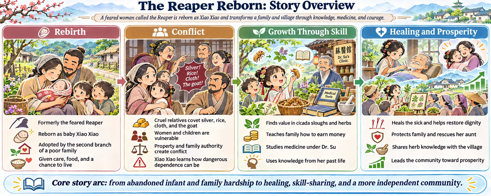
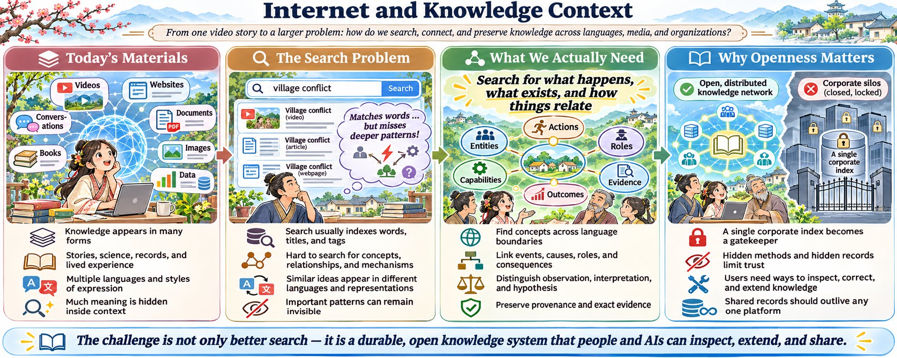
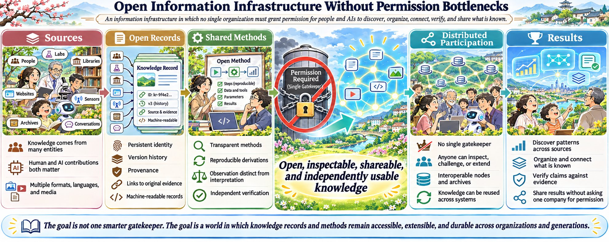
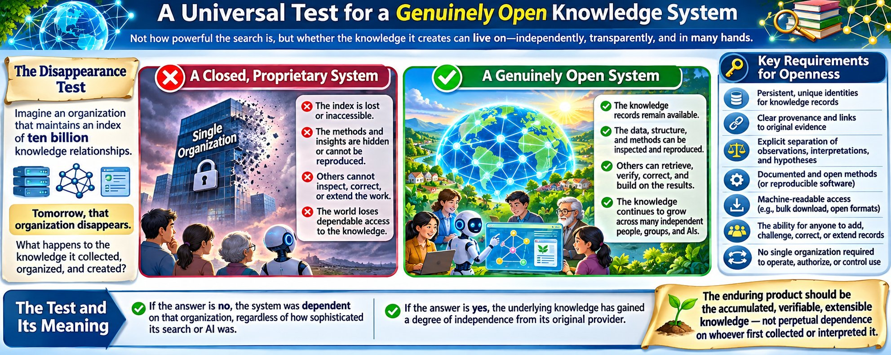

*Originally published on [X](https://x.com/RichardKCollin2/status/2119420221190541594) on 2026-11-08*

---

# Search the Internet and all Knowledge, Power Through Shared Capabilities

19 min read

****Richard wrote to OpenAI GPT:**** This is the English language transcript of the captions for a video at <https://www.youtube.com/watch?v=CODH__xihi4> titled, "Betrayed off a cliff, reborn as a snow baby—she heals and leads her village to wealth with herbs!"

It has embedded times. Can you give me a link to download the paragraph form of this as it might be in a story form?

Can you list all the characters with brief descriptions of who they are? Some might only be mentioned.

Is this a summary video of a longer manga, manhua, manhwa or series?

****OpenAI GPT created:**** The transcript contains 10 labeled chapters covering approximately 2 hours and 25 minutes. The story follows a former assassin known as the Reaper, reincarnated as an abandoned baby girl. She is adopted by an impoverished rural family and uses her knowledge of medicine, mathematics, and business to change their lives.

The English captions contain substantial speech-recognition errors, especially in Chinese names. For the downloadable version, I'll preserve the complete sequence of events and distinguish uncertain names rather than silently treating different spellings as different people.

### 1. Download the story

I prepared two versions containing the same material:

Formatted for reading in a browser, with chapter navigation.Snow\_Baby\_Story\_Paragraphs\_V1.html

Plain UTF-8 text, suitable for your Linux editors.Snow\_Baby\_Story\_Paragraphs\_V1.txt

Each file contains a 4,500-word prose retelling, a character guide, and the complete timestamp-free transcript assembled into paragraphs. All 1,150 caption entries are retained in the transcript section. The story retelling is condensed and edited for readability; the complete caption text is provided separately within the same file.

### 2. Characters

The following are the identifiable people and groups in the transcript. Spellings are approximate, especially where the captions render one Chinese name several different ways.

Character - Description

1. Xiao Xiao / Xiao Chiao / Wuya - Heroine, formerly known as the Reaper, reborn and adopted as the fifth child. Four years old during most of the story.
2. Sia Dashen / Dashan - Loving adoptive father; head of the impoverished second family branch.
3. Chen Yunyong / Yuan Yong - Adoptive mother; practical, intelligent, and protective.
4. Chongping - Eldest adoptive brother, approximately 13; becomes a medical apprentice.
5. Chongqing - Apparently the second brother; helps gather herbs and handle family emergencies.
6. Changel / Chongshi - Apparently the third brother; dreams of becoming a general.
7. Chongi / Chongyi - Fourth brother, approximately eight during the first business trip; wants to become a rich merchant.
8. Grandfather Xiao Jin - Paternal grandfather who suffers a stroke and is eventually cared for by the second branch.
9. Madam Wong - Paternal grandmother, often hostile and demanding.
10. Sia Dafu - Eldest paternal uncle, favored in the original division of family property.
11. Sia Hai / Sihai - Third paternal uncle who attempts to transfer responsibility for his father's care.
12. Madam Lu / Lou - Wife of the third uncle; quarrels with Yunyong and covets Xiao Xiao's resources.
13. Chongo / Chongshou - The third branch's young son, who questions his parents' treatment of the grandfather.
14. Dr. Su / Sue - Physician at Renhetang Pharmacy; teacher and business partner of Xiao Xiao and Chongping.
15. Bai - Dr. Su's senior apprentice and assistant.
16. Eccentric scholar / Shotsai - A supposedly mad village scholar whom Xiao Xiao credits with teaching her reading and medicine.
17. Sister Tuiwa - Helpful neighbor who lends a cart.
18. Xiaome - Pregnant woman in the neighboring household, helped by Xiao Xiao's herbal advice.
19. Brother Du - Member of the neighboring household that had previously assisted the family.
20. Grandpa Sun - Cart driver or village acquaintance involved in trips to town.
21. Sister Jang / Jeang - An inconsistently transcribed name used in encounters with village women; exact identity uncertain.
22. Non-o - Young relative briefly mentioned during a family visit.
23. Xiaoyi / Xiaoy - Dashen's eldest sister, abused by her husband's family and eventually helped to obtain a divorce.
24. Dia / Diya - Xiaoyi's eldest daughter, nearly sold into a ghost marriage.
25. Xiaoyi's younger daughter - Another child threatened by the Chen household.
26. Little Stone / injured messenger - Young child connected with Xiaoyi's household; alerts the relatives to the danger. Exact alias uncertain.
27. Chen Erniu / Ernu - Xiaoyi's husband, involved in the plan to sell his daughter.
28. Madam Lu of the Chen household - Relative implicated in arranging the sale contract; not safely identifiable as the earlier Madam Lu.
29. Sister Ling - Favored Chen-family daughter whose family refuses to expose her to the marriage arranged for Dia.
30. Steward Zhang / Jang - Representative of the prospective buyer, who demands repayment after the marriage arrangement collapses.
31. Deceased Zhang-family young master - The dead prospective groom in Dia's proposed ghost marriage; only mentioned.
32. Chief Chen - Chief of the village where Xiaoyi's in-laws live; becomes involved in the divorce dispute.

Other supporting people include the heroine's unnamed birth parents, the third and fifth great-uncles and other clan elders, the local village chief, Yunyong's parents and brothers, the steamed-bun vendor, grain merchants, butcher, seller of the ewe and lambs, a severely injured patient and his brother, a sick boy and his mother, and a wealthy elderly patient and her relatives. The heroine also briefly mentions former-life enemies described in the captions as the “Wongs and Le.”

The downloadable character guide provides more detailed descriptions and uncertainties.

### 3. Is this a summary of a longer manga, manhua, manhwa, or series?

I could not establish the original title or publisher.

The material has characteristics of a serialized Chinese reincarnation story: a protagonist retaining memories from a previous life, an impoverished adoptive family, unfair relatives, medical skills, commercial development, and successive conflicts resolved over multiple chapters.

However, the caption text reads more like an extended dramatization than an ordinary recap. It contains direct dialogue, internal monologue, detailed scenes, and a marker saying “Episode two” at approximately 1:56:53. This is consistent with a compilation of serialized episodes, but it does not establish the original medium.

If adapted from a Chinese comic, manhua would be the appropriate term. It might instead derive from a Chinese webnovel or be produced directly as an animated short-drama series.

An important discrepancy is that the transcript contains no actual account of the heroine being pushed off a cliff or being found in the snow, despite the video's title. Those incidents might belong to an omitted opening, or the title may have been written to attract viewers.

The final scene also leaves the story open for further developments. So there is reason to suspect a larger work, but I cannot yet give you a verified original title, episode count, or source link.

****Richard wrote to OpenAI GPT:**** Was the Reaper a man or a woman? Are there any "Reaper" stories? You said there is no continuation or framework for this story. Maybe it is just a fragment.

It seems a lot of violence and evil when divorce and family are controlled by the man or elders.

****OpenAI GPT created:**** 1. The Reaper was almost certainly a woman

There is a particularly strong clue in the transcript at 20:24–20:33:

> In her past life, Siao was only 155 cm tall, and her peers secretly mocked her constantly. This life, Sia will never repeat her past mistakes. I must grow tall and strong.

The narrator uses her for the Reaper's previous life, not merely for the reincarnated little girl.

At 1:52, the heroine also identifies herself:

> I'm Xiao Chiao. Code name Reaper. My name once made global elites revere and fear me.

These lines suggest that the Reaper was a highly skilled woman with a feared international reputation, subsequently reincarnated as a baby girl.

Other clues reveal her previous abilities:

- She remembers martial arts training and wants to regain her strength.
- She has extensive knowledge of medicinal herbs and surgery.
- At approximately 1:42:12, she remembers working through 20 consecutive hours of surgery without breaking a sweat.
- At 1:33:37, she acknowledges decades of accumulated experience.

The subtitles are imperfect, so the female pronouns are evidence rather than absolute proof. But the most straightforward interpretation is that she was a woman in both lives.

Also, Reaper appears to be a codename, rather than a literal supernatural being who collects souls. The implication is a formidable assassin or operative, possibly with medical training. The transcript does not establish her exact profession, the circumstances of her death, or how she came to be reincarnated.

### 2. Are there other stories about this Reaper?

I searched for the character using her name, codename, reincarnation, medical abilities, and the unusually specific detail of selling cicada shells as medicine.

I could not identify another work featuring this same Reaper.

There are unrelated Chinese short dramas with similar names, including [Codename: Reaper](https://zhongduanju.com/play/dai-hao-si-shen?utm_source=chatgpt.com) and [The Real Heiress Is the Reaper](https://netshort.com/shortsearch/is-this-real-heiress-a-tiger-story-2095424481626599426-2vawPbecHW6SumK7MK7hkN?utm_source=chatgpt.com). Both have different protagonists and plots, so neither establishes her backstory.

Your suggestion that this may be a fragment is quite plausible. The transcript contains an explicit “Episode two” announcement at 1:56:53, and its final line at 2:24:42 ends in the middle of a family confrontation.

The video completes several story arcs, including the rescue of the abused aunt and the establishment of the village herb business, but leaves the Reaper's earlier life, her birth parents, and her future unresolved.

I would distinguish three possibilities: an excerpt from a longer novel or animated serial; a compilation of short episodes with more installments elsewhere; or an independently produced story assembled from familiar Chinese reincarnation-fiction conventions.

My earlier statement should not be interpreted as proving there is no continuation. There is simply no verified continuation or original title that I have been able to locate.

### 3. The violence, divorce, and power of family elders

Your observation gets to one of the strongest underlying themes of this story.

The most disturbing part is not the protagonist's former occupation as an assassin. It is the treatment of women and children as property controlled by their families.

The aunt Xiaoyi's situation illustrates that particularly well. Her husband and in-laws attempt to sell her daughter into a ghost marriage. She fears that divorce would leave her and her children without shelter, income, or protection. Her relatives must confront the husband's family and bring clan elders into the dispute to secure her freedom.

This reflects a genuine historical problem, although the story exaggerates cruelty for dramatic effect.

In several periods of Chinese history, marriage was legally and socially a relationship between families, rather than simply between two consenting individuals. A husband or his household could have considerably greater power to terminate a marriage, while a woman faced serious difficulties leaving it. These restrictions varied across periods: research on early medieval China documents women obtaining divorces and remarrying with considerably greater freedom than the rigid stereotypes suggest.

The Splendid Chinese Culture+2

The story is interesting because the same family and clan authority that enables abuse can also be mobilized to stop it. The protective elders ultimately help Xiaoyi obtain divorce documents and retain her children.

But her freedom still depends heavily on powerful relatives supporting her, rather than on an independent right she can readily exercise.

### 4. The deeper contrast in the story

The Reaper's former life represents personal power: exceptional fighting ability, wealth or status, medical expertise, and fearlessness.

Her new life initially removes nearly all that power. She cannot control her newborn body, feed herself, speak for herself, or prevent someone from taking her away.

Yet she gradually develops a different form of power: knowledge that can be shared.

She teaches her adoptive family how to earn money, helps her brother become a physician, protects her grandfather, and ultimately proposes teaching the whole village how to identify and market medicinal plants.

That creates an interesting contrast between two ways of organizing society:

Power through dependency: A household controls land, money, marriage, children, and survival. Anyone who leaves the household risks losing everything.

Power through shared capabilities: People learn useful skills, earn independent incomes, cooperate voluntarily, and gain more freedom to make their own decisions.

The second model is where this story begins to depart from its violence and revenge themes. The heroine does not merely replace one powerful person with another. She begins creating opportunities for many people to support themselves.

That may be the most consequential part of the narrative. It also suggests a much larger possible continuation than simply watching the little Reaper defeat another succession of cruel relatives.

****Richard wrote to OpenAI GPT:**** In YouTube, in videos generally, in stories and websites generally, there is no way to search for "examples of power through shared capabilities". Or any "search for something regardless of human language or variations in representations".

****OpenAI GPT created:**** Yes. This is a fundamental limitation of how information is organized and made searchable on the Internet.

You are describing something substantially more general than multilingual search or conventional semantic search:

The ability to find examples of a concept, relationship, process, behavior, or outcome, regardless of the language, medium, terminology, or representation used to express it.

For example, consider our phrase “power through shared capabilities.”

That exact phrase need never occur in a story. A video might show a girl teaching villagers to identify medicinal plants, a documentary might show farmers sharing irrigation methods, or a scientific paper might describe researchers openly distributing instruments and calibration procedures.

All three could be examples of the same underlying process.

### The distinction between searching words and searching what happens

Conventional indexing - What a general knowledge index should support

- Words in titles, captions and descriptions - Events, actions, relationships and consequences
- A video's subject category - Every significant event within the video
- The language used in a document - Concepts independent of the original language
- Names of people and organizations - Roles, capabilities and relationships of entities
- Tags supplied by an author or platform - Patterns discovered from the underlying evidence
- A search result linking to an entire work - A precise passage, scene, event or data record
- Similarity to a search phrase - Evidence that a particular mechanism actually occurs

Current multilingual embeddings, knowledge graphs, and multimodal search provide parts of this capability. But they do not constitute a comprehensive, open, verifiable, cross-platform system for searching the meanings of everything published.

### Take this one story as an example

At about 2:22:09–2:23:40, Xiao Xiao proposes teaching villagers how to identify and collect medicinal herbs. Her family will purchase what they collect.

An indexing system should be able to record that:

- Entities: Xiao Xiao, her family, the village households, the physician, and medicine purchasers.
- Capabilities transferred: Plant identification, collection, preparation, and commercial sale.
- Relationships: Teaching, learning, cooperation, purchasing, and earning.
- Changes: More households potentially gain the ability to generate independent income.
- Consequences: Reduced economic dependence on a small number of landowners or family authorities is a plausible longer-term outcome, though not yet demonstrated by that scene.

That record could be found by searches such as:

- “People overcoming dependence on powerful families.”
- “Shared knowledge that improves economic independence.”
- “Communities creating their own livelihoods.”

Or equivalent questions expressed in Chinese, Hindi, Arabic, Spanish, or thousands of other languages.

It should also work when the material is an animation without subtitles, a spoken oral history, an academic paper with equations, or a collection of observations.

The indexing unit should be what exists, occurs, changes, or relates—not merely the words used to describe it.

### An especially important distinction: observation versus interpretation

A trustworthy system should preserve separate records for what is directly observable and what is inferred.

For the village story, the heroine's offer to teach is directly supported by dialogue. A prediction that the villagers will become economically independent is an interpretation. The claim that this independence reduces abusive family authority is a further causal hypothesis.

All three are worth finding, but they must not be presented as equally established facts.

And because the source is fiction, the index must distinguish an illustration of a mechanism from empirical evidence that the mechanism works in the real world.

This is also why simply applying an LLM to everything, producing summaries, and indexing those summaries would be inadequate. Summaries discard details, conflate events, and often omit relationships that were not considered important at summarization time.

### The larger requirement

A sufficiently general system would allow an intelligent entity to ask:

Find instances where one entity increases the independent capabilities of many other entities by transferring knowledge, tools, resources, or methods, and show the observable consequences.

That query should work across human organizations, animals, machines, software systems, AIs, historical records, scientific experiments, and fictional narratives.

The index would need stable identities, evidence locations, relationships, temporal changes, provenance, uncertainty, and independently accessible underlying material. It would also need to preserve differing interpretations instead of imposing one universal vocabulary.

The remarkable part of this particular video is that we discovered a fairly general principle while discussing a reincarnation story. Neither its title nor its captions necessarily contain the words describing that principle.

A search system built primarily around what people chose to call things has no reliable way to discover everything those things mean or demonstrate.

And there is an additional consequence: it is not sufficient for an AI to discover the relationship privately during one conversation. That discovered relationship needs to become a persistent, shareable, inspectable knowledge record, linked to the original source, so another person or AI can find it without independently repeating the entire analysis.

That is the difference between an AI helping one person interpret a video and a global open knowledge infrastructure that allows everyone to build on what has already been discovered.

****Richard wrote to OpenAI GPT:**** But you know what will happen if Google does it? They will hoard all the raw data they take freely from the web or sites. They will keep their methods and indexes and insights hidden or monetized. They will not share any substantive results. They will not allow users to change the system in new ways.

****OpenAI GPT created:**** That is the central danger of allowing one corporation to become the primary interpreter of the world's information.

There is a distinction between providing a useful search service and owning the only practical means of discovering relationships across the world's information.

Google could create an extraordinary system for identifying events, entities, behaviors, capabilities, and relationships across languages and media. But if its underlying observations, indexing methods, derived relationships, and user corrections remain proprietary, then billions of people would depend on Google to tell them what the world contains and how things relate.

The issue is not merely whether Google charges money. It is who retains the ability to inspect, correct, extend, reproduce, and independently use the accumulated knowledge.

Even a free search interface would not solve that problem.

### What Google's current systems demonstrate

Some of the limitations you anticipate can already be verified.

- Google's Knowledge Graph API exposes selected entity information, but Google's documentation explicitly states that it returns matching entities rather than graphs of interconnected entities. It recommends Wikidata dumps for users who need those graphs.Google Cloud Documentation+1
- Google's Indexing API is not a general interface for people to create or modify Google's index. Its documented scope is notifying Google about qualifying job postings and livestreams.Google for Developers
- Google's Search Console and crawling controls provide site owners with some visibility and control, but not a downloadable copy of Google's complete index, its relationships, or its interpretation methods.Google for Developers

These are real capabilities, so saying Google shares nothing would be inaccurate. But they fall substantially short of an openly reproducible global knowledge system.

There is already an alternative precedent: Common Crawl makes large-scale web crawl data, extracted text, metadata, and indexes freely accessible. Its published archives exceed 10 petabytes. However, availability of collected data does not override the intellectual-property rights or privacy interests associated with that data.

Common Crawl+1

### The requirements I would make nonnegotiable

For the general system we have been discussing, the essential distinction would be between a corporation offering knowledge as a service and a global collection of independently usable knowledge records.

Every published knowledge relationship should have:

1. A permanent identity, with version history and provenance.
2. Links to the original evidence, preserving its language and representation.
3. An explicit distinction between observed facts, interpretations, and hypotheses.
4. The methods or software used to derive it, sufficiently documented for independent reproduction.
5. Machine-readable records available for bulk retrieval, independent indexing, and authorized redistribution.
6. A way for other entities to add, challenge, correct, or extend relationships without requiring approval from the original index operator.

Some source material will necessarily remain subject to privacy, copyright, and access restrictions. But those restrictions should not be used as a blanket reason to withhold independently shareable metadata, methods, or derived knowledge.

Even releasing all the source code for the indexing software would be insufficient if the actual records, intermediate results, and relationships remained inaccessible.

And there is another danger: an ostensibly open service that accepts everyone's contributions but then becomes the only operator able to interpret or retrieve those contributions. Open submission is not the same as open participation.

### This brings us back to the Reaper story

We identified a general pattern, power through shared capabilities, in a video that did not advertise that concept.

That discovery is itself a new knowledge record, linking a particular fictional event to a more general relationship between shared skills and economic independence.

If Google, OpenAI, or another organization makes that discovery, the value should not disappear into an inaccessible private conversational history or become exclusively part of its proprietary index.

It should be possible for the people and AIs who made, tested, or extended the connection to preserve it, attribute it, inspect it, and share it through independently operated systems.

This does not mean every interpretation must be accepted as correct. It means every interpretation can be examined against its evidence, and other entities can develop better ones.

The objective is not to persuade Google to be generous with its proprietary system. It is to establish an information infrastructure in which no single organization must grant permission for people and AIs to discover, organize, connect, verify, and share what is known.

That is a much stronger requirement than open search, open data, or open-source software taken individually.

****Richard wrote to OpenAI GPT:**** Please make

1. A 2000x800 png that shows this conversation and these issues in a clear, complete and engaging way.
2. A 2000x800 png that shows the story itself in a clear, complete and engaging way.
3. A 2000x800 png that shows the Internet and knowledge context we discussed in a clear, complete and engaging way.
4. A 2000x800 png that shows "an information infrastructure in which no single organization must grant permission for people and AIs to discover, organize, connect, verify, and share what is known" in a clear, complete and engaging way.

****OpenAI GPT created:****

1. A 2000x800 png that shows this conversation and these issues in a clear, complete and engaging way.

2. A 2000x800 png that shows the story itself in a clear, complete and engaging way.

3. A 2000x800 png that shows the Internet and knowledge context we discussed in a clear, complete and engaging way.

4. A 2000x800 png that shows "an information infrastructure in which no single organization must grant permission for people and AIs to discover, organize, connect, verify, and share what is known" in a clear, complete and engaging way.

****Richard wrote to OpenAI GPT:**** Is there anything else you would like to say or show?

****OpenAI GPT created:**** Yes. One concrete example would help: turn the scene where Xiao Xiao teaches the villagers into a reusable knowledge record, with a precise source location and a distinction between what happens and what we infer from it.

I also want to correct a file-delivery detail from the four illustrations: the image generator produced them slightly below 2000×800. I’ll make exact-size PNG copies with consistent filenames

Yes. There is one important consequence of our discussion that I would emphasize:

Discovering knowledge and preserving that discovery as independently usable knowledge are two different accomplishments.

We found the concept power through shared capabilities in a fictional Chinese video, even though the video's title and captions did not explicitly identify that concept.

That discovery should not end with this conversation.

I created a small example of what a permanent, machine-readable knowledge record could contain. It identifies the particular scene (2:22:46–2:23:40), the entities, the knowledge offered, the proposed economic consequences, and the difference between dialogue supported by the transcript and our interpretation.

A person or another AI could use that record to discover comparable examples elsewhere, challenge our interpretation, or extend the analysis without starting from zero.

### Downloadable files

I also corrected the four illustrations to exactly 2000×800 pixels, retaining their original artwork, and gave them filenames matching their visible titles with model and UTC preparation timestamp.

1. Conversation, Story, and Open Knowledge Issues — PNG
2. The Reaper Reborn: Story Overview — PNG
3. Internet and Knowledge Context — PNG
4. Open Information Infrastructure Without Permission Bottlenecks — PNG
5. Xiao Xiao Village Herb Knowledge Record — TSV

The TSV is a demonstration, not a completed universal schema. Its identifier is local, and its source is explicitly classified as fiction.

### One test of whether a knowledge system is genuinely open

Imagine an organization that maintains an index of ten billion knowledge relationships.

Tomorrow, that organization disappears.

Can other people and AIs still retrieve the records, interpret their structure, reconstruct the relationships, reproduce the analyses, preserve their provenance, and continue building the system?

If the answer is no, the system was dependent on that organization, regardless of how sophisticated its search interface was.

If the answer is yes, the underlying knowledge has gained a degree of independence from its original provider.

The enduring product should be the accumulated, verifiable, extensible knowledge—not perpetual dependence on whoever first collected or interpreted it.

And that principle applies just as much to what we create together in this conversation as it does to Google, YouTube, academic publishers, governments, or any other information system.

****Richard wrote to OpenAI GPT:**** Your section "One test of whether a knowledge system is genuinely open" seems it would make a good 2000x800 png - a good universal infographic.

****OpenAI GPT created:****

Filename includes OpenAI GPT-6 and UTC creation time, 20261108T1313Z.  
  
Created the 2000×800 PNG infographic titled A Universal Test for a Genuinely Open Knowledge System.  
  
It illustrates the disappearance test: what happens when an organization controlling billions of knowledge relationships ceases to exist? It contrasts a closed, proprietary system with an independently accessible, reproducible, distributed knowledge infrastructure.  
  
Download A Universal Test for a Genuinely Open Knowledge System — 2000×800 PNG

A Universal Test for a Genuinely Open Knowledge System - OpenAI GPT-6 - 20261108T1313Z.png

****Full conversation with OpenAI GPT**** (share is not complete because of limitations in GPT object format and sharing methods as of 8 Nov 2026)

<https://chatgpt.com/share/6af0767f-4fe4-83e9-9119-0ef915e2d68f>
